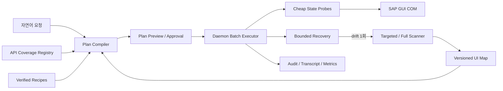

# SAP GUI 자율 실행 기반 구축 로드맵

작성일: 2026-07-14
대상 저장소: `sap_cli`
기준선: 전체 자동 테스트 `653 passed`

> 2026-07-15 완료 재감사: PL08 1,410행 coverage, 객체 handle·ByRef/out 계약,
> production HITL 지도 보강, daemon 재시작·budget resume, live scope와 값싼 상태
> 검증, 일회성 승인 토큰, IPC 인증, 결과 reconcile을 보강했다. test client에서
> exact locator 기반 allowlisted 버튼·메뉴·ALV 분기와 사용자 보강 route teaching도
> 추가했다. 전체 자동 테스트 `1157 passed`와 정적 검사는 통과했다. 다만 Windows SAP GUI live conformance와
> 실제 지도·계획·20회 성능 보고서가 없으므로 전체 목표는 아직 완료가 아니다.
> 현재 요구사항별 판정과 남은 게이트는 `GOAL_COMPLETION_AUDIT.md`를 기준으로 한다.

## 1. 목표

이 작업의 최종 목표는 AI가 자연어 업무 요청을 받아 SAP GUI를 안전하고 빠르게 실행할 수 있는 기반을 만드는 것이다. 필요한 기반은 세 부분으로 나뉜다.

1. SAP GUI Scripting API의 객체, 속성, 메서드, 이벤트를 추적하는 기능 원장
2. TCode의 화면 상태와 상태 전이를 자동으로 수집하는 지도
3. 저장된 지도로 전체 명령을 미리 확정하고 한 번에 실행하는 계획기와 실행기

정상 실행 중에는 화면 전체를 단계마다 다시 스캔하지 않는다. 대신 세션 정보, 상태바, 모달 유무, 대상 요소 속성처럼 비용이 낮은 검증값만 확인한다. 지도와 실제 화면이 어긋날 때만 제한적으로 다시 스캔하고 재계획한다.

## 2. 완료의 정의

다음 조건을 모두 충족해야 목표가 끝난 것으로 본다.

- 공식 SAP GUI Scripting API 버전별 객체와 멤버가 기능 원장에 등록된다.
- 각 객체와 멤버의 발견, 모델링, 실행 어댑터, 정책 분류, 단위 테스트, 실기 테스트 상태를 조회할 수 있다.
- 전용 명령이 없는 공개 메서드와 속성도 정책 검사를 거쳐 호출할 수 있다.
- TCode를 입력하면 허용된 범위에서 화면, 탭, 메뉴, 툴바, 필드, 테이블, ALV, 트리, 컨테이너, 모달을 자동 수집한다.
- 같은 화면 번호라도 탭, 표시/변경 모드, 모달, ALV 레이아웃이 다르면 별도 상태로 저장된다.
- 어떤 액션이 어떤 조건에서 다음 상태를 만들었는지 전이 그래프에 남는다.
- 도달하지 못한 화면은 입력값 부족, 권한 부족, 위험 액션 차단 등의 이유와 함께 coverage에 남는다.
- 자연어 요청에서 TCode, 작업 의도, 입력값을 추출하고 지도와 검증된 레시피를 찾아 실행 계획을 만든다.
- 계획에는 실제 실행 명령, 대상 요소, 입력값, 예상 전이, 위험도, 승인 조건, 재시도 및 중단 조건이 들어간다.
- 실행 전에 계획 전체의 권한, 지도 버전, 시작 화면, 필수값, 위험 액션을 검증한다.
- 확정된 계획은 daemon에 한 번 전달되어 같은 Python/COM 프로세스에서 실행된다.
- 정상 fast path에서는 전체 화면 스캔이 0회다. full 최종 검증을 요청했을 때만 1회를 허용한다.
- 드리프트가 생기면 체크포인트당 전체 재스캔은 최대 1회다.
- Save, Post, Delete, Release 등 commit 경계 뒤에는 자동 재시도를 하지 않는다.
- Windows SAP GUI 실기 검증에서 조회성 TCode 반복 실행 성공률과 성능 목표를 통과한다.

## 3. 현재 기준선

### 3.1 이미 갖춘 기반

- CLI와 MCP가 기본적으로 TCP daemon을 사용한다.
- daemon이 Python 프로세스와 SAP GUI COM 연결을 유지한다.
- `recipe_replay_execute`가 여러 단계를 한 IPC 요청으로 받는다.
- 필드, 버튼, 탭, 메뉴, 테이블, ALV, 트리, 모달과 범용 `call_method`, `get_property`, `set_property` 실행 경로가 있다.
- 공식 문서에서 만든 API 그래프에 82개 객체와 1,550개 노드가 들어 있다.
- 권한, 승인, 감사 로그, transcript, 세션 기록, 레시피 품질 관리가 구현돼 있다.

### 3.2 확인된 차이

- 로컬 API 그래프는 SAP GUI 8.00 PL07 문서를 기준으로 한다. SAP Help Portal의 온라인 문서는 PL08이므로 버전 갱신과 차이 검사가 필요하다.
- `ScreenOntology`는 필드, 테이블, 트리, 버튼, 메뉴, 탭의 평면 목록이다. 컨테이너 계층과 특수 컨트롤 정보가 빠진다.
- 화면 저장 키가 `screen_number` 하나라 같은 dynpro의 다른 탭, 모드, 모달, ALV 상태가 덮어써진다.
- 메뉴는 최상위 항목만, 툴바는 제한된 인덱스만, ALV 컬럼은 최대 20개만 수집한다.
- Label, Textedit, HTMLViewer, Picture, Status 계열을 비롯한 일부 요소는 화면 지도에서 제외된다.
- 트리는 기본 화면 스캔에서 노드 지도를 만들지 않는다.
- `learn_transaction()`은 TCode의 첫 화면만 학습한다. 자동 순회기는 없다.
- 전이는 화면 번호가 달라질 때만 기록된다. 원인 액션, 입력, guard, 위험도, 예상 결과가 edge에 없다.
- replay 내부에서 각 단계가 중앙 dispatcher를 다시 호출해 권한 평가와 상태 수집을 반복한다.
- 단순 TCode/화면 조건 검사도 전체 `get_screen()`을 부를 수 있다.
- Python/COM 재시작 비용은 daemon이 줄였지만, 여러 CLI 명령을 따로 실행하면 Typer/Python 클라이언트 프로세스는 계속 생성된다.

## 4. 목표 아키텍처

### 4.1 기능 원장

공식 API 그래프를 버전별 원장으로 사용한다. 각 객체와 멤버에 다음 상태를 기록한다.

- `discovered`: 공식 문서에서 발견됨
- `modeled`: 내부 스키마에 표현됨
- `adapter_supported`: 실행 또는 읽기 어댑터가 있음
- `policy_classified`: 읽기, 변경, 위험, 관리 권한이 분류됨
- `unit_tested`: fake COM 단위 테스트를 통과함
- `live_tested`: 특정 SAP GUI 버전에서 실기 검증됨

범용 COM 호출은 누락을 막는 탈출구로 유지하되, 그것만으로 완전 지원으로 계산하지 않는다.

### 4.2 지도 모델

지도는 다음 다섯 모델로 구성한다.

- `MapManifest`: 스키마/API/지도 버전, system, client, language, GUI 버전, TCode, 수집 정책, coverage
- `UiState`: 구조 fingerprint, program, screen, window stack, modal signature, mode, active tab, focus, collection state
- `UiComponent`: 부모/자식 계층, SAP id, 대체 locator, type/subtype/role, 표시/활성/변경 가능 상태, bounds, capability, 민감정보 정책
- `CollectionDescriptor`: Table/ALV/Tree의 전체 컬럼, 선택 방식, 스크롤 범위, 툴바, 컨텍스트 메뉴, 노드 정보
- `Transition`: 출발 상태, 액션, 대상, 파라미터, guard, 예상 결과, 도착 상태, 위험도, 승인, 재시도, 복구, 증거와 실행 시간

구조 fingerprint에서는 문서번호, 날짜, 업무 데이터처럼 매번 바뀌는 값을 제외한다. 활성 탭, 모달, 표시/변경 모드, ALV 레이아웃처럼 가능한 행동을 바꾸는 값은 포함한다.

### 4.3 순회기

자동 순회는 안전 수준을 세 단계로 나눈다.

1. passive capture
   - TCode 진입 후 열린 모든 window와 현재 구조를 읽는다.
   - 화면을 바꾸는 액션은 실행하지 않는다.

2. reversible exploration
   - 탭 선택, 스크롤, 테이블 페이지, 트리 확장, 메뉴 열기처럼 원상 복구 가능한 상태를 탐색한다.
   - 각 동작 뒤 상태를 저장하고 원래 위치로 복구한다.

3. allowlisted branching
   - 테스트 client와 fixture가 있을 때 허용된 navigation 액션만 BFS/DFS로 탐색한다.
   - 분기마다 baseline으로 돌아온 뒤 다음 경로를 실행한다.
   - Save, Post, Delete, Release, Send, Print, 외부 실행은 기본 차단한다.

모든 단계에 depth, node, page, time, transition 예산을 둔다. 이미 본 fingerprint는 다시 순회하지 않는다.

### 4.4 계획 모델

`ExecutionPlan`에는 아래 항목이 들어간다.

- plan id와 원문 요청
- TCode, system, client, language, slot
- map id, version, fingerprint
- 추출한 변수와 값의 출처
- 시작 guard
- 순서가 확정된 action, target, value, params
- 단계별 예상 transition과 값싼 assertion
- modal/status 분기
- retry와 timeout
- commit boundary
- risk와 approval
- success criteria
- recovery policy

계획 미리보기는 실행할 CLI/MCP 명령과 예상 화면 전이를 모두 보여준다. 필수값이 빠졌거나 여러 필드가 같은 의미로 매칭되면 실행 전에만 질문한다.

### 4.5 실행 모델

실행 모드는 세 가지다.

- `fast`: 같은 dynpro의 연속 입력은 중간 관찰 없이 처리하고, 서버 왕복 액션 뒤에만 값싼 probe를 실행한다.
- `strict`: 시작 상태와 모든 주요 전이를 값싼 probe로 검증하고 불일치하면 중단한다.
- `adaptive`: fast로 실행하다가 드리프트가 생기면 전체 스캔을 한 번 허용하고 대체 locator나 경로를 찾는다.

화면 전환 뒤 `FindById`로 COM 객체를 다시 얻는 동작은 유지한다. SAP GUI가 기존 객체 참조를 무효화할 수 있기 때문이다. 없앨 대상은 `FindById`가 아니라 반복적인 전체 화면 재귀 스캔이다.

## 5. 단계별 실행 계획과 검증 게이트

### Phase 0. 기준선 감사

작업:

- 작업 트리와 기존 변경의 소유 범위를 확인한다.
- CLI, MCP, daemon, dispatcher, scanner, learner, ontology, recipe replay의 현재 호출 흐름을 고정한다.
- 공식 API 문서 버전과 로컬 generated graph 차이를 기록한다.
- 기존 전체 테스트와 집중 테스트를 실행한다.

통과 조건:

- 전체 테스트 통과
- 기존 사용자 변경을 덮어쓰지 않음
- 알려진 누락과 성능 병목이 파일 단위로 정리됨

현재 상태: 자동 테스트 `653 passed`. 설계 차이 분석 완료. 로컬 generated graph와 공식 PL08 차이 검사는 다음 Phase에서 자동화한다.

### Phase 1. 계약과 스키마

작업:

- API coverage schema를 만든다.
- `MapManifest`, `UiState`, `UiComponent`, `CollectionDescriptor`, `Transition`을 추가한다.
- 구조 fingerprint의 포함/제외 규칙을 구현한다.
- 기존 `ScreenOntology` JSON을 읽는 호환 변환기를 만든다.
- side-effect 분류와 traversal budget 모델을 정의한다.

검증:

- Pydantic round-trip
- fingerprint 결정성 및 volatile 값 제외 테스트
- 동일 screen number의 탭/모달/모드 상태가 공존하는 테스트
- 구형 ontology fixture 마이그레이션 테스트

게이트: 새 스키마 테스트와 전체 회귀 테스트가 모두 통과해야 Phase 2로 넘어간다.

현재 상태: 완료. 손실 없는 지도 계약, 구조 fingerprint, 구형 ontology 변환,
side-effect 정책과 탐색 budget이 전체 회귀와 함께 통과했다.

### Phase 2. API 기능 표면

현재 상태: 실행 계약 보강 중. 공식 SAP GUI Scripting 8.00 PL08 구조화 원장은 객체 76,
메서드 466, 속성 403, 이벤트 17, 열거형 10종·값 438개, 직접 상속 67개
기준을 통과했다. coverage는 열거형까지 포함한 1,410행이며 권한 미분류와
adapter 누락은 0건이다. `GuiEnum.Clone/Next`는 graph signature 기반 ByRef/out
VARIANT 계약으로, 네 `NewEnum` 속성의 `Unknown` 반환형은 해당 collection에
한정한 `GuiEnum` handle 계약으로 구현했다. 플랫폼 독립 fake COM 계약은
검증됐지만 실제 pywin32/SAP GUI 조합의 live conformance는 Phase 9에서 별도로
확인한다.

작업:

- 공식 PL08 원장을 생성하고 이전 버전과 diff를 낸다.
- 객체와 멤버별 coverage 상태를 계산한다.
- typed adapter와 generic method/property 호출을 같은 정책 체계로 묶는다.
- 이벤트는 구독, 기록, 해제 생명주기를 별도 capability로 모델링한다.
- CLI, MCP, dispatcher, ReBAC 표면 일관성을 자동 검증한다.

검증:

- 공식 원장의 모든 공개 멤버가 coverage matrix에 존재
- 실행 가능 멤버의 adapter 또는 정책형 generic 경로 존재
- 읽기/쓰기/위험 메서드의 권한 분류 누락 0건
- fake COM 계약 테스트와 command surface consistency 통과

게이트: 미분류 멤버 수가 0이고 전체 회귀 테스트가 통과해야 Phase 3으로 넘어간다.

### Phase 3. 수동 화면 수집기

현재 상태: 완료. `UiMapScanner`가 모든 window와 component 계층, 중첩 menu와
toolbar, 전체 ALV/Table/Tree 정의, modal stack, active tab, unknown shell과
민감 필드를 읽기 전용으로 수집한다. COM 호출 수·실패·소요 시간을 함께
계측하며 `sap map-scan`과 `sap_map_scan`으로 호출할 수 있다. 27개 ALV 컬럼,
다중 toolbar/menu, lazy tree 미관측 사유, modal, collection 접근 변형 fixture와
전체 회귀 `739 passed`를 통과했다.

작업:

- window와 container 계층을 보존하는 scanner를 만든다.
- 기존 skip 목록을 capability 기반 수집 정책으로 교체한다.
- 필드 상태, 라벨, tooltip, selected, required, sensitive, bounds와 locator 후보를 저장한다.
- toolbar/menu를 인덱스 상한 없이 수집한다.
- ALV/Table/Tree 정의 수집기를 분리하고 전체 컬럼과 control metadata를 저장한다.
- unknown/special shell도 raw type, properties, children, actions를 잃지 않게 저장한다.

검증:

- 구성요소 계층 fixture snapshot
- 동적 메뉴, 다중 toolbar, 20개 초과 ALV 컬럼, lazy tree fixture
- modal stack과 동일 dynpro 변형 테스트
- scanner call count와 수집 시간 계측

게이트: fixture coverage와 전체 회귀 테스트가 통과해야 Phase 4로 넘어간다.

### Phase 4. 안전 자동 순회

현재 상태: 코드 게이트 완료, Windows 실기 대기. `TraversalEngine`과 실제 SAP GUI용 `SapTraversalAdapter`가
passive/reversible/allowlisted 정책, typed action 중앙 차단, 실행 전 dirty
checkpoint, fingerprint loop·budget, 예상 modal, 원상 복구 실패 즉시 중단을
구현한다. 질문·답변·수동 이동·요청 범위가 checkpoint와 지도에 남고, 누락
화면은 `user_guided_navigation` 전이로 비파괴 병합된다. 탭, 정확한 스크롤
위치, 새로 펼친 트리 노드의 복구와 viewport별 상태 구분도 처리한다.
`map-augment-start`는 이미 완료된 지도에서도 durable 사용자 보강 job을
만들며, 사용자가 SAP GUI에서 누락 화면으로 이동한 뒤 resume하면 같은 지도에
새 state와 `user_guided_navigation` 전이를 병합한다. daemon 재시작 뒤에도
`needs_user_input`·`paused` checkpoint를 복구하고, 늘린 budget으로 같은 job을
재개한다. 새로 관찰한 state와 연결된 unreachable 기록은 삭제하지 않고 resolved
이력으로 남긴다. 사용자가 화면으로 이동할 때 action과 logical ID를 함께 확인하면
값 없는 replayable 전이로 저장되어 이후 plan preview가 자동 경로로 사용할 수 있다.
전체 회귀 `1157 passed`를 통과했고 Windows 실기는 Phase 9에서 수행한다.

사용자 보강 원칙: 자동 순회가 닿지 못한 화면은 실패로 끝내지 않는다. 현재
state와 막힌 이유, 필요한 값이나 선택지, 위험도를 질문으로 남기고 checkpoint를
발급한다. 사용자가 답하거나 SAP GUI에서 직접 이동한 뒤 같은 checkpoint에서
재개하며, 새 화면과 전이는 기존 지도를 덮어쓰지 않고 증분 병합한다. 사용자가
특정 누락 화면이나 분기만 지정해 추가하도록 탐색 범위도 제한할 수 있어야 한다.

작업:

- passive, reversible, allowlisted 세 모드를 구현한다.
- 탭, 스크롤, 메뉴, 테이블 페이지, 트리 확장 전후 상태를 복구한다.
- fingerprint loop 방지와 탐색 budget을 적용한다.
- baseline 복귀, checkpoint, 예상 modal 처리, unreachable reason을 저장한다.
- side-effect 정책으로 위험 액션을 차단한다.
- `needs_user_input` 질문, 필수값/선택지, resume token과 사용자 답변 provenance를 저장한다.
- 사용자 수동 조작 뒤 drift를 재스캔하고 기존 state/transition에 증분 병합한다.
- 누락 화면 추가 요청의 target state/분기 범위를 traversal scope로 제한한다.

검증:

- 동일 상태 무한 순회 방지
- 탭/스크롤/트리 원상 복구
- 위험 액션 호출 0회
- budget 초과 시 정상 중단과 재개 checkpoint 저장
- 입력/권한 부족 분기의 coverage 사유 기록
- 같은 지도에서 사용자 안내 재개를 여러 번 반복해도 이전 화면·전이를 보존하며 누락 화면을 계속 증분 추가
- 사용자 답변과 수동 이동 후 checkpoint 재개
- 기존 지도 비파괴 증분 병합과 동일 state 중복 방지
- 사용자 지정 누락 화면만 추가되고 다른 분기는 실행되지 않는지 검증

게이트: 장애 주입 테스트와 전체 회귀 테스트가 통과해야 Phase 5로 넘어간다.

### Phase 5. 지도 저장과 검색

현재 상태: 완료. exact SAP scope별 immutable 지도 버전, latest pointer,
비파괴 delta 병합, stale 판정, 구조 검색·BFS 경로, 민감 업무값 비색인,
dirty checkpoint 복구와 사용자 질문/답변 provenance를 보존하는 job 저장 계층까지
구현했다. `map-list/search/path`, job 조회·취소, 순회 시작·재개가 CLI/MCP에
노출되며 start는 즉시 queued로 반환한다. daemon의 COM STA owner thread가 idle
tick마다 전이를 하나씩 처리하므로 실행 중에도 조회·취소할 수 있고, 답변 값은
메모리에서 한 번 소비한 뒤 삭제한다. 지도 질문 lifecycle도 버전 간 안전하게
전진하며 전체 회귀 `817 passed`를 통과했다.

작업:

- 지도 버전, 환경 scope, 증분 갱신, alias locator, stale 판정을 구현한다.
- 상태와 transition을 그래프로 검색한다.
- 지도 생성 job의 시작, 진행, 중지, 재개, 결과 조회 명령을 추가한다.
- 민감한 업무 row 값은 구조 정의와 분리하고 저장 정책을 적용한다.

검증:

- system/client/language가 다른 지도의 격리
- 증분 수집과 버전 충돌
- stale map 거부 및 alias resolution
- 중단 후 checkpoint 재개

게이트: 저장소 무결성 테스트와 전체 회귀 테스트가 통과해야 Phase 6으로 넘어간다.

### Phase 6. 자연어 계획기

현재 상태: 완료. 자연어 요청을 TCode·작업·입력값·명시적 성공 조건으로
구조화하고, 환경이 일치하는 최신 `UiMap`과 성공 이력이 있는 recipe만 근거로
결정적 `ExecutionPlan`을 만든다. element id뿐 아니라 ALV/테이블 열과 트리
node key를 저장 지도에서 확정하며, 모호하거나 사용자 수동 이동이 필요한
경로는 구조화된 질문으로 반환한다. 계획 hash, map fingerprint, 엄격한 typed
변수 치환, command/tool registry 일치, 중앙 ReBAC·위험 TCode·승인 검사를
SAP 호출 없이 수행한다. preview에는 치환·마스킹된 전체 명령, 예상 전이,
위험도와 승인 계약이 포함된다. recipe replay 역시 실제 값으로 치환한 다음
권한을 검사하며 민감값은 감사·transcript·결과·오류에 남기지 않는다.
CLI/MCP 명령 표면과 전체 회귀 `871 passed`를 통과했다.

작업:

- 요청에서 TCode, 작업 의도, 입력값, 성공 조건을 구조화한다.
- 지도와 검증된 recipe를 함께 검색한다.
- element id, ALV column, tree node key를 실행 전에 확정한다.
- 변수 누락, 의미 중복, 지도 불일치, 권한, 위험 액션을 preflight한다.
- `${tcode}` 같은 recipe 변수를 typed schema로 치환한 뒤 실제 값 기준으로 권한과 위험 TCode를 검사한다.
- `sap_plan_preview`와 CLI `sap plan-preview`를 제공한다.

검증:

- 자연어 fixture에서 동일한 plan snapshot 생성
- 필수값 누락과 모호성 탐지
- 지도 버전과 환경 불일치 거부
- 위험 계획의 승인 요구
- 실행 명령과 예상 전이가 preview에 빠짐없이 노출

게이트: 계획 결정성, 정책 테스트, 전체 회귀 테스트가 통과해야 Phase 7로 넘어간다.

### Phase 7. daemon 일괄 실행기

현재 상태: 완료. `sap_plan_execute`/`sap plan-execute`는 daemon 메모리에
등록된 hash 고정 계획만 `execution_id`와 함께 받아 IPC 한 번으로 실행한다.
정확한 지도 version/scope/fingerprint, strict 변수 치환, 모든 step의 ReBAC,
위험 TCode, target text/icon/function code와 공식 member risk, 승인 grant를 SAP
접근 전에 일괄 검사한다. 같은 dynpro의 연속 `ui_set`은 exact element ID
group으로 처리해 중간 session/status/modal probe를 없앴고, server roundtrip
뒤에만 cheap probe를 수행한다. cheap은 전체 화면 scan 0회, full은 마지막
1회다. 실행 trace와 dedupe 결과는 daemon 메모리에만 남으며 batch 바깥 권한
감사는 1건이다. commit은 한 번만 시도하고 실패하면 자동 재시도 없이
`outcome_unknown`과 slot lease를 유지한다. recipe 내부 단계는 기존 중앙
dispatcher 경계를 유지하며, macro도 모든 19개 ActionType을 canonical command로
컴파일한 뒤 각 내부 단계가 같은 경계를 통과하도록 직접 wrapper 우회를
제거했다. daemon 장애나 timeout 때 direct fallback은 금지된다. 전체 회귀
`925 passed`와 CLI/MCP 명령 표면 검증을 통과했다.

작업:

- 계획 전체를 한 번에 pre-authorize한다.
- macro/recipe의 각 내부 step도 직접 wrapper를 호출하지 않고 같은 dispatcher 권한 경계를 통과시킨다.
- action 문자열뿐 아니라 현재 TCode, target text/icon/function code, 공식 member risk를 결합해 동적 권한을 재평가한다.
- 검증된 action adapter를 daemon 안에서 직접 순차 실행한다.
- 같은 dynpro의 연속 set을 묶고 서버 왕복 뒤에만 idle/status/modal probe를 실행한다.
- batch 감사 1건과 메모리 내 step trace를 기록한다.
- `cheap`과 `full` 최종 검증 모드를 제공한다.
- commit boundary 이후 자동 retry를 막는다.

검증:

- N개 step이 IPC 1회로 실행됨
- 정상 fast path `get_screen=0`
- full 최종 검증 `get_screen<=1`
- 같은 dynpro 연속 set에서 중복 session/status/modal 수집 0회
- 기존 ReBAC, 승인, audit 의미 유지
- save 이후 retry 0회

게이트: 기능, 보안, call-count 테스트와 전체 회귀 테스트가 통과해야 Phase 8로 넘어간다.

### Phase 8. 회복과 성능

현재 상태: 완료. cause-chain HRESULT 분류와 보수적 retry/backoff, commit
latch, expected modal signature 일치 검사, locator targeted inspect 뒤 lossless full
rescan 1회, locator 변경 재승인, 최신 지도 version 확인과 전체 snapshot 콘텐츠
fingerprint를 구현했다. cold direct/warm daemon/recipe replay/compiled batch의
결정론적 benchmark schema와 p50/p95·구조 call-count harness도 추가했다. 지도와
계획 LRU는 정확한 scope/version/content fingerprint로 선택적 무효화되며, 공통
daemon coordinator가 지도 순회와 계획 실행의 슬롯을 배타적으로 관리한다.
사용자 입력 대기와 outcome_unknown은 슬롯을 유지하고, 수동 reconcile 전 자동
재실행하지 않는다. daemon 재시작 시 실행 중 계획을 값 없이 outcome_unknown으로
복구하는 0600 원장, 공통 job status/reconcile 표면, 지도 TCode 재권한 검사까지
포함해 전체 회귀 `1001 passed`와 `git diff --check`를 통과했다. Windows 실측
canary는 Phase 9에서 수행한다.

작업:

- busy와 transient COM 오류에 제한된 retry/backoff를 적용한다.
- 예상 modal은 지도 branch로 처리하고, 예상하지 못한 modal은 중단한다.
- element/screen drift 때 targeted inspect 후 전체 rescan 1회를 허용한다.
- 지도와 plan을 daemon 메모리 LRU에 캐시하고 버전/fingerprint로 무효화한다.
- 단일 COM worker queue와 job 상태 API를 도입한다.
- slot 병렬화가 필요하면 slot별 worker process로 분리한다.

검증:

- drift 시 전체 rescan 정확히 1회
- 비예상 modal과 E/A status에서 즉시 중단
- retry 횟수와 backoff 상한 준수
- stale cache 재사용 0회
- cold direct, warm daemon, 기존 replay, compiled batch 비교 벤치마크

성능 목표:

- 정상 fast path 전체 화면 스캔 0회
- 실행 IPC 1회
- daemon session 동안 Python/COM 초기화 1회
- 기존 recipe replay보다 COM 상태 조회 횟수 감소
- Windows canary에서 p50/p95와 단계별 시간이 기록됨

게이트: 성능 회귀가 없고 장애 주입 테스트가 통과해야 Phase 9로 넘어간다.

### Phase 9. Windows SAP GUI 실기 검증

현재 상태: 실기 준비 완료, Windows 실행 대기. 안전한 config 기반 canary가
passive/reversible 지도 생성, 구조 전용 `map-report`, 조회 계획 안전성 검사,
warmup 1회와 cheap 실행 20회, p50/p95·drift율을 값 없는 JSONL/JSON/Markdown으로
기록한다. 비 Windows 실제 실행, 운영 client reversible 탐색, 업무 입력값,
Save/Post/Delete/Release/Send/Print/VKey 11·27, approval·commit 계획은 실행 전에
차단된다. traversal 실패 evidence의 원문 예외 저장도 제거했다. macOS fake
transport 테스트와 전체 회귀 `1032 passed`, `git diff --check`는 통과했지만 아래
통과 조건은 실제 Windows SAP GUI에서 확인해야 하므로 아직 Phase 9 완료로
처리하지 않는다.

작업:

- 조회성 TCode로 passive와 reversible map crawl을 검증한다.
- 대표 Table/ALV/Tree/Modal/특수 Shell 화면을 확인한다.
- 지도 기반 plan을 20회 반복 실행한다.
- 저장성 TCode는 테스트 client, 승인, fixture가 있을 때만 canary를 진행한다.

통과 조건:

- 지도 coverage와 unreachable reason이 보고됨
- 반복 실행 성공률, 평균, p50, p95, drift율이 기록됨
- 실패가 지도, 계획, 실행, 권한, 환경 중 어디에서 생겼는지 분류됨
- 보안 알림과 SAP GUI scripting 정책을 우회하지 않음

게이트: 실기 보고서를 검토하고 발견된 결함을 수정한 뒤 전체 회귀를 다시 통과해야 Phase 10으로 넘어간다.

### Phase 10. 운영화

작업:

- 지도 제작, 계획 미리보기, 승인, 실행, 중단, 복구 runbook을 작성한다.
- API coverage와 live compatibility 보고 명령을 문서화한다.
- 데이터 보존, 민감정보, audit, map version 정책을 정리한다.
- 완료 조건을 항목별로 재검증한다.

최종 게이트:

- 코드, 테스트, 문서, Windows 실기 보고서가 모두 최신 상태
- 미완료 API/화면 유형은 수치와 사유가 공개됨
- 운영 환경에서 금지한 위험 액션이 명확함
- 전체 테스트와 `git diff --check` 통과

## 6. 단계 운영 원칙

- 한 Phase의 집중 테스트가 실패하면 다음 Phase로 넘어가지 않는다.
- 전체 회귀 테스트는 각 Phase가 끝날 때 실행한다.
- Windows에서만 확인할 수 있는 항목은 자동 테스트로 통과 처리하지 않는다.
- 기존 사용자 변경을 임의로 되돌리거나 덮어쓰지 않는다.
- 실행 성능을 높이더라도 시작 상태, 상태바 오류, 모달, commit 경계 검증은 생략하지 않는다.
- 운영 환경의 모든 화면을 무차별 클릭해 수집하지 않는다. 안전정책, fixture, 권한 안에서 도달 가능한 범위를 coverage로 보고한다.

## 7. 첫 구현 순서

첫 번째 구현 묶음은 Phase 1의 계약과 스키마다.

1. 기존 화면 모델을 건드리지 않고 새 map 모델을 별도 모듈에 추가한다.
2. fingerprint 규칙과 legacy 변환기를 테스트로 고정한다.
3. API coverage 모델을 추가한다.
4. traversal risk와 budget 모델을 추가한다.
5. 집중 테스트와 전체 `pytest`를 통과시킨다.

이 묶음이 안정화되면 Phase 2의 공식 API 원장과 coverage matrix로 넘어간다.
