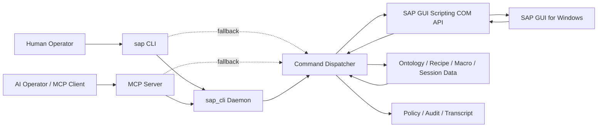
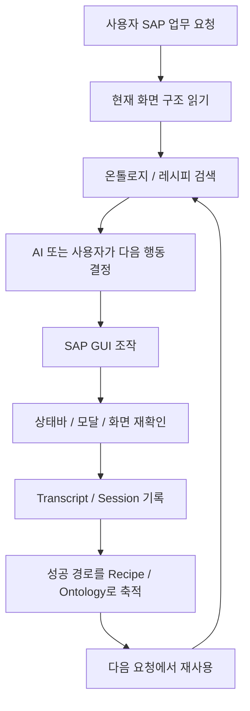
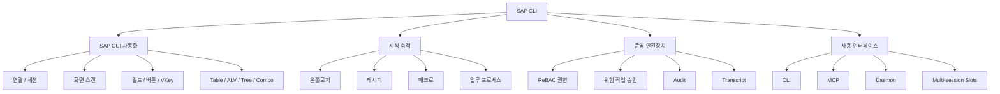

# PRD — SAP CLI

작성 기준: 2026-05-09
분석 대상: `sap_cli` 프로젝트 현재 작업트리
검증 기준: `.venv/bin/python -m pytest -q` 실행 결과 `599 passed`

## 1. 제품 한 줄 정의

SAP CLI는 SAP GUI for Windows의 Scripting COM API를 CLI와 MCP 도구로 감싸서, AI 에이전트와 사람이 SAP GUI 화면을 구조적으로 읽고 조작하며, 성공한 업무 경로를 온톨로지/레시피/세션 기록으로 축적하는 자동화 도구다.

## 2. 제품 배경

SAP GUI는 화면 중심 업무 시스템이라 AI 에이전트가 직접 다루기 어렵다. 기존 자동화 방식은 주로 VBS 매크로나 RPA 스크립트처럼 좌표/화면 상태에 민감하고, 업무 맥락을 이해하지 못하며, 성공 경로를 재사용 가능한 지식으로 남기기 어렵다.

이 프로젝트는 다음 문제를 해결한다.

- SAP GUI 화면 요소를 JSON 구조로 읽어 AI가 현재 상태를 판단할 수 있게 한다.
- SAP 트랜잭션, 필드, 화면, 업무 프로세스, 필드 의존성을 온톨로지로 축적한다.
- 성공한 조작 경로를 레시피로 저장해 다음 실행에서 탐색 비용을 줄인다.
- MCP 도구로 Claude/Codex류 AI 에이전트가 SAP를 조작할 수 있게 한다.
- 권한, 승인 필요 작업, 감사 로그, transcript를 통해 운영 위험을 낮춘다.

### 2.1 제품 컨텍스트 다이어그램

### 2.2 제품 가치 흐름 다이어그램

## 3. 대상 사용자

### 3.1 AI Operator

SAP 업무 요청을 받아 CLI/MCP 도구를 순차 호출하는 AI 에이전트다.

필요한 것:

- 현재 SAP 화면의 필드, 버튼, 테이블, 트리 구조
- 안전한 입력/버튼/키보드 조작 도구
- 작업 후 상태바와 모달 확인
- 이전 성공 경로 검색
- 실패 시 재실행 전 검토 자료

### 3.2 Human Operator

SAP를 실제로 운영하는 사람 또는 개발자다.

필요한 것:

- `sap connect`, `sap screen`, `sap run`, `sap fill` 같은 명령형 인터페이스
- 반복 업무를 매크로/레시피로 저장하는 기능
- 데이터 디렉터리 상태 확인, 백업, 정리
- 권한 문제를 CLI에서 진단하는 기능

### 3.3 Supervisor / Admin

AI 에이전트의 SAP 접근 권한과 레시피 품질을 관리하는 운영자다.

필요한 것:

- 조회/실행/쓰기/관리 권한 분리
- 위험 트랜잭션 실행 전 승인 요구
- 감사 로그와 transcript 조회
- 후보 세션을 검토해 레시피로 승인
- 실패한 레시피 비활성화/재활성화

### 3.4 Verifier

이미 수행된 작업이 올바른지 확인하는 검증 전용 에이전트다.

필요한 것:

- 읽기 중심 MCP 도구 표면
- transcript 기반 재실행 검토
- SAP 상태, 화면, 모달, 온톨로지 문맥 조회

## 4. 제품 목표

### 4.1 1차 목표

- SAP GUI 화면 자동화의 기본 조작을 CLI/MCP로 제공한다.
- AI가 SAP 화면을 구조화된 JSON으로 읽고 다음 행동을 결정할 수 있게 한다.
- 레시피와 온톨로지를 통해 반복 업무의 탐색 비용을 줄인다.
- 권한/승인/감사/기록 기반의 운영 안전장치를 제공한다.

### 4.2 2차 목표

- 여러 SAP 세션을 slot 단위로 분리하여 병렬 작업 기반을 제공한다.
- 업무 프로세스 단위의 end-to-end 흐름을 정의하고 실행 상태를 추적한다.
- SAP GUI Scripting API 그래프 기반으로 전용 명령이 없는 컨트롤도 안전하게 조작한다.
- Windows 실기 검증 절차를 문서화해 실제 SAP GUI 환경에서 회귀를 확인한다.

## 5. 비목표

현재 제품의 직접 목표가 아닌 것:

- SAP 서버 자체의 RFC/BAPI 직접 호출
- SAP 권한 객체의 대체 구현
- 운영 시스템에서 승인 없는 생성/변경/삭제 자동 실행
- SAP GUI for Java/macOS/Linux 직접 제어
- OCR 기반 좌표 클릭 자동화
- 전사 RPA 플랫폼 전체 대체

## 6. 핵심 가치 제안

1. AI 친화적 SAP GUI 인터페이스
   - 화면을 JSON 온톨로지로 반환한다.
   - 필드명, 라벨, 버튼, 테이블, 트리, 상태바를 분리해 제공한다.

2. 안전한 조작 흐름
   - 조작 전후 상태를 transcript로 기록한다.
   - 위험 트랜잭션과 위험 리포트에 승인 요구를 걸 수 있다.
   - 상태바 오류와 모달 상태를 결과에 포함한다.

3. 지식 축적
   - 성공한 세션은 레시피 후보가 된다.
   - 승인된 레시피는 이후 AI 검색/실행 계획에 재사용된다.
   - 온톨로지에 트랜잭션, 필드, 화면, 프로세스, 문서 흐름을 저장한다.

4. 운영성
   - CLI와 MCP 양쪽을 지원한다.
   - daemon 모드로 COM 연결을 유지해 반복 호출 비용을 줄인다.
   - 데이터 백업/정리/상태 진단 기능을 포함한다.

### 6.1 핵심 기능 맵

## 7. 주요 기능 요구사항

### 7.1 SAP GUI 연결

제품은 실행 중이고 로그인된 SAP GUI 세션에 연결해야 한다.

요구사항:

- 첫 번째 연결/세션 기본 연결을 지원한다.
- connection/session index 지정 연결을 지원한다.
- SAP system ID, 즉 SID 기반 자동 연결을 지원한다.
- 현재 열려 있는 모든 connection/session 목록을 조회할 수 있어야 한다.
- COM 세션이 끊긴 경우 이전 연결 파라미터로 재연결을 시도해야 한다.
- 재연결 후 system ID가 달라지면 안전하게 거부해야 한다.

주요 명령:

- `sap connect`
- `sap connect --system PR1`
- `sap connections`
- MCP `sap_connect`, `sap_connections`

### 7.2 화면 읽기

제품은 현재 SAP 화면의 구조를 JSON으로 반환해야 한다.

요구사항:

- 현재 transaction, screen number, program, title을 반환한다.
- 필드 목록을 id/name/type/label/value/changeable/required 등으로 반환한다.
- 버튼, 탭, 메뉴, 테이블, 트리 정보를 반환한다.
- `fields_only`, `actions_only`, `search` 필터를 제공한다.
- 모달이 떠 있으면 가능한 범위에서 모달 창을 대상으로 읽어야 한다.
- GetObjectTree 사용 가능 환경에서는 object tree 기반 분석을 우선하고, 실패하면 manual scan으로 fallback해야 한다.

주요 명령:

- `sap screen`
- `sap screen --fields-only`
- `sap screen --actions-only`
- `sap screen --search "MATNR"`
- MCP `sap_screen`

### 7.3 기본 SAP 조작

제품은 SAP GUI의 일반 조작을 안전한 명령으로 제공해야 한다.

요구사항:

- 트랜잭션 실행
- OK code 명령 전송
- 필드 값 설정/조회
- 여러 필드 일괄 입력
- 버튼 클릭
- 탭 선택
- VKey 전송
- 상태바 조회
- 모달 존재 여부와 텍스트 조회

주요 명령:

- `sap run MM03`
- `sap command "/nMM03"`
- `sap set <element_id> <value>`
- `sap fill MATNR=100-100`
- `sap get <element_id>`
- `sap press <element_id>`
- `sap vkey 0`
- `sap status`
- `sap modal`

### 7.4 고급 컨트롤 지원

제품은 SAP GUI 주요 컨트롤을 전용 또는 범용 액션으로 다뤄야 한다.

요구사항:

- GuiComboBox entries 조회와 key/value 매핑 선택
- GuiTableControl 읽기/행 선택/셀 더블클릭
- GuiGridView 및 ALV Grid 읽기
- ALV 스크롤 기반 row 수집
- Tree control 읽기/선택/확장/접기/더블클릭/버튼 클릭
- scrollbar 조작
- context menu 조작
- toolbar button/menu 조작
- window maximize/minimize 등 window action
- 명시적 property get/set과 method call fallback

주요 명령:

- `sap combo-entries`
- `sap inspect`
- `sap act`
- `sap table`
- `sap table-select`
- `sap table-doubleclick`
- `sap tree`
- `sap tree-select`
- `sap tree-expand`
- `sap tree-press`

### 7.5 SAP GUI Scripting API 그래프

제품은 SAP GUI Scripting API를 내장 그래프로 제공해 조작 추론을 보조해야 한다.

요구사항:

- component type, intent, node id 기반 subgraph query를 제공한다.
- live element 검사 결과에 API graph preflight를 포함한다.
- seed graph와 generated graph를 병합할 수 있어야 한다.
- 공식 SAP GUI Scripting API 문서에서 그래프를 재생성하는 스크립트를 제공한다.

주요 명령:

- `sap scripting-query --type GuiComboBox --intent select`
- MCP `sap_scripting_query`
- MCP `sap_inspect_element`

### 7.6 온톨로지

제품은 SAP 업무 도메인 지식을 JSON 기반 온톨로지로 관리해야 한다.

요구사항:

- 트랜잭션별 화면, 필드, 버튼, 테이블, action path를 저장한다.
- 필드 registry를 통해 같은 SAP 필드가 여러 transaction에서 어디에 쓰이는지 찾는다.
- 필드 의존성과 문서 흐름을 조회한다.
- 업무 프로세스를 저장하고 프로세스 경로를 탐색한다.
- 자연어 Q&A를 통해 저장된 온톨로지 기반 답변을 제공한다.
- 현재 화면을 학습해 ontology에 반영한다.
- 필드 의미와 필드 의존성 수동 annotation을 지원한다.

포함된 seed 지식:

- 트랜잭션: `MM03`, `VA01`, `VL01N`, `VF01`, `ME21N`, `MIGO`, `MIRO`
- 프로세스: 기본 자재 조달, 판매→출하→대금청구
- 패턴: 저장 흐름, F4 검색 도움말
- SAP GUI Scripting API seed graph

### 7.7 매크로

제품은 사용자가 SAP 조작 단계를 매크로로 기록하고 재생할 수 있게 해야 한다.

요구사항:

- 매크로 녹화 시작/단계 기록/undo/finish/cancel/status를 지원한다.
- record step은 기록과 실제 SAP 실행을 함께 수행한다.
- 변수 자동 감지와 변수 치환 재생을 지원한다.
- dry-run을 제공한다.
- 매크로 저장/조회/목록/삭제를 지원한다.
- tree action도 매크로 step으로 지원한다.

주요 명령:

- `sap record-start`
- `sap record-step`
- `sap record-finish`
- `sap macro-play`
- `sap macro-show`
- MCP `sap_macro_*`

### 7.8 세션 기록과 레시피

제품은 AI 실행 세션을 기록하고 성공한 핵심 흐름을 레시피로 전환해야 한다.

요구사항:

- `session-start` 후 실행되는 CLI/MCP step을 세션에 자동 기록한다.
- SAP step뿐 아니라 bash/manual/excel marker step도 기록할 수 있어야 한다.
- 성공 세션 중 핵심 flow 조건을 만족하는 세션을 candidate로 표시한다.
- supervisor가 candidate를 승인하면 recipe로 저장한다.
- recipe에는 tcode sequence, ownership, version, replay success criteria, step precondition을 포함할 수 있어야 한다.
- recipe 검색은 hybrid retrieval을 사용해야 한다.
- recipe 실행 성공/실패를 기록하고 품질 점수에 반영해야 한다.
- 반복 실패 recipe는 자동 비활성화될 수 있어야 한다.
- 비활성 recipe 재활성화와 버전업을 지원해야 한다.

검색/품질 요구:

- BM25 lexical score
- lightweight semantic overlap
- tcode boost
- step_kind boost
- success/failure/replay 품질 점수
- matched snippets와 match reasons 제공

### 7.9 Recipe replay

제품은 저장된 recipe를 바로 실행하기 전 검증 계획을 생성하고, 허용된 step만 실행해야 한다.

요구사항:

- replay plan은 precheck, dry-run plan, execute, verify, report 흐름을 보여준다.
- recipe가 disabled 상태이면 기본적으로 차단한다.
- 현재 tcode/screen과 recipe 시작 조건이 다른 경우 이슈를 표시한다.
- 실행 가능한 step allowlist를 적용한다.
- step별 권한/승인/위험 트랜잭션 preflight를 수행한다.
- step precondition을 실행 직전에 확인한다.
- 실행 후 SAP status, modal, screen summary를 검증한다.
- custom success criteria를 저장/재사용/초기화할 수 있어야 한다.
- 성공/실패 결과를 자동 report해 품질 메트릭에 반영할 수 있어야 한다.

현재 CLI/MCP 공통 노출 기능:

- `sap_recipe_replay_plan`
- `sap_recipe_replay_execute`
- `sap_recipe_version_up`

### 7.10 MCP 연동

제품은 AI 에이전트가 사용할 MCP 서버를 제공해야 한다.

요구사항:

- MCP tool definition은 dispatcher command registry와 drift 없이 일치해야 한다.
- 현재 구현 기준 79개 MCP tool을 제공한다.
- policy가 enforcing이면 agent profile에 따라 노출 tool이 제한되어야 한다.
- MCP는 기본적으로 daemon 경유 실행을 사용한다.
- 오래된 daemon이 새 명령을 모르면 direct dispatch로 fallback해야 한다.
- MCP 세션 시작/종료는 active session id를 자동 추적해야 한다.

### 7.11 CLI

제품은 사람이 직접 사용할 수 있는 Typer 기반 CLI를 제공해야 한다.

요구사항:

- 모든 명령은 JSON으로 출력한다.
- 기본적으로 daemon 경유를 사용하고, 환경변수로 direct dispatch를 강제할 수 있어야 한다.
- 전역 slot 지정으로 multi-session 사용을 지원해야 한다.
- 권한 거부와 승인 필요 상태를 JSON으로 표현해야 한다.
- auth 진단, data 진단, daemon 관리 명령을 제공해야 한다.

### 7.12 Daemon

제품은 SAP GUI COM 연결 유지와 호출 성능 향상을 위해 daemon을 제공해야 한다.

요구사항:

- localhost TCP 서버로 실행한다.
- `ping`, `shutdown`, 일반 dispatcher command를 처리한다.
- CLI/MCP context를 daemon dispatch context로 보존한다.
- daemon 미실행 시 CLI/MCP가 자동 시작할 수 있어야 한다.
- daemon 오류/미실행 시 direct dispatch fallback이 가능해야 한다.

### 7.13 Multi-session slot

제품은 여러 SAP 세션을 slot으로 분리해야 한다.

요구사항:

- 기본 slot은 `ses0`이다.
- slot별 SapGuiWrapper를 보관한다.
- slot id validation을 수행한다.
- max sessions와 TTL sweep을 지원한다.
- slot allocate/release/list를 지원한다.
- agent assignment를 기록할 수 있어야 한다.

### 7.14 보안, 권한, 승인, 감사

제품은 ReBAC 형태의 agent policy를 제공해야 한다.

요구사항:

- relation은 viewer/operator/supervisor/owner를 지원한다.
- permission은 read/execute/write/admin을 지원한다.
- agent별 resource relation을 설정할 수 있어야 한다.
- 위험 트랜잭션과 위험 report에 approval_required 또는 deny 정책을 적용할 수 있어야 한다.
- MCP tool surface는 권한 profile에 따라 숨겨질 수 있어야 한다.
- audit log는 민감 arguments를 sanitization해야 한다.
- CLI auth 진단 명령으로 현재 policy, visible tools, 특정 tool 판단 결과를 볼 수 있어야 한다.

기본 위험 트랜잭션 예:

- `SM30`: 테이블 직접 수정
- `SE38`, `SA38`: ABAP 프로그램 실행
- `SU01`: 사용자 관리
- `SE16`: 테이블 데이터 접근
- `SM21`: 시스템 로그

### 7.15 Transcript와 재실행 검토

제품은 모든 주요 실행을 transcript JSONL로 남기고, 재실행 전 검토 계획을 제공해야 한다.

요구사항:

- before/after session/status/modal/screen summary를 기록할 수 있어야 한다.
- denied, approval_required, error, success outcome을 기록해야 한다.
- transcript query는 command/tool/agent/outcome/text 필터를 지원해야 한다.
- transcript plan은 위험도, 재실행 가능 여부, precondition, 권장 확인 순서, CLI 재실행 명령을 제안해야 한다.

### 7.16 데이터 진단/백업/정리

제품은 사용자 데이터 디렉터리를 운영 가능하게 관리해야 한다.

요구사항:

- 데이터 위치를 조회한다.
- 카테고리별 파일 수와 크기를 조회한다.
- recipe/macro/ontology/session/transcript/audit 등의 백업 archive를 생성한다.
- 오래된 log/session/transcript/audit 파일을 dry-run 또는 apply로 정리한다.

### 7.17 화면 캡처

제품은 현재 SAP GUI 화면을 캡처하고 목록화해야 한다.

요구사항:

- Windows 환경에서 SAP GUI 창을 찾아 이미지로 저장한다.
- tcode/screen/label 기반 파일명을 생성한다.
- 저장된 캡처 목록을 조회한다.

## 8. 비기능 요구사항

### 8.1 안정성

- 저장 파일은 atomic write를 사용해야 한다.
- partial write와 short write에서 기존 파일이 손상되지 않아야 한다.
- directory fsync는 가능한 범위에서 수행해야 한다.
- JSON read 실패는 안전하게 처리해야 한다.
- path traversal은 저장소 계층에서 차단해야 한다.

### 8.2 테스트 가능성

- Windows SAP GUI COM 의존 기능은 mock 기반 단위 테스트로 최대한 검증한다.
- 실제 SAP GUI는 별도 Windows 검증 체크리스트로 확인한다.
- 현재 자동 테스트는 599개이며 모두 통과한다.

### 8.3 호환성

- Python 3.11 이상을 지원한다.
- SAP GUI COM 제어는 Windows 전용이다.
- macOS/Linux에서는 코드 분석, 단위 테스트, 문서 작업은 가능하지만 실제 SAP GUI COM 실행은 불가능하다.

### 8.4 관측 가능성

- 모든 명령은 JSON 출력이어야 한다.
- 상태바, 모달, 화면 요약을 조작 결과에 포함할 수 있어야 한다.
- audit, transcript, session 로그를 통해 누가 무엇을 왜 실행했는지 추적할 수 있어야 한다.

### 8.5 보안

- policy가 없으면 개발 편의를 위해 allow_all이 가능하다.
- policy가 있으면 agent relation에 따라 도구 노출과 실행 권한이 제한된다.
- 위험 트랜잭션은 approval_required 또는 deny로 차단 가능해야 한다.
- 운영에서는 최소 권한 profile 사용이 기본 원칙이다.

## 9. 성공 지표

정량 지표:

- 자동 테스트 통과율 100%
- MCP tool definition과 command registry drift 0
- 레시피 replay 성공률 상승
- 반복 실패 recipe 자동 비활성화 건수
- 세션 후보에서 승인된 recipe 전환율
- SAP 화면 탐색 step 수 감소

정성 지표:

- AI가 화면 ID를 추측하지 않고 `screen/inspect/scripting-query` 기반으로 조작한다.
- 사람이 transcript만 보고 작업 흐름을 재현/검토할 수 있다.
- Supervisor가 위험 작업과 레시피 품질을 CLI로 관리할 수 있다.

## 10. 운영 제약

- 실제 SAP GUI 자동화는 Windows + SAP GUI for Windows + SAP GUI Scripting 활성화가 필요하다.
- SAP 서버 측 scripting 허용이 필요하다.
- SAP GUI 보안 팝업, 테마, 커스텀 dynpro, HTML/custom control에 따라 일부 요소 접근이 제한될 수 있다.
- 운영 시스템에서는 생성/변경/삭제 트랜잭션에 승인 정책을 반드시 적용해야 한다.
- SAP 업무 데이터, 스크린샷, transcript, audit에는 민감정보가 포함될 수 있으므로 저장/공유 정책이 필요하다.

## 11. 현재 구현 상태 요약

- Python 패키지: `sap-cli` version `0.1.0`
- 엔트리포인트: `sap = sap_cli.cli:app`
- 주요 의존성: `pydantic`, `typer`, `rich`, Windows 한정 `pywin32`, `Pillow`
- 선택 의존성: `mcp`
- 개발 의존성: `pytest`
- 현재 Python 코드 규모: 약 21,345 lines
- 현재 command registry: 79 commands
- 현재 MCP tools: 79 tools
- 현재 CLI 노출 command: 77개
- 현재 테스트: 599 passed

## 12. 제품 로드맵 제안

### 단기

- Windows SAP GUI 실기 검증 결과를 기반으로 COM wrapper edge case 보완
- daemon과 MCP 설치/업데이트 UX 개선
- recipe replay CLI 표면 확장 후 Windows SAP 실기 검증
- generated SAP GUI Scripting API graph 생성 절차 자동화

### 중기

- 레시피 품질 대시보드 또는 report command 추가
- transcript 기반 실패 원인 자동 분류 강화
- custom SAP 화면/Z transaction 온톨로지 학습 UX 개선
- 팀/공유 scope 기반 recipe governance 강화

### 장기

- 실제 운영 승인 workflow와 연결
- SAP 업무별 검증 템플릿 확장
- AI agent별 작업 분리와 병렬 session orchestration 고도화
- 레시피 추천 품질 평가 데이터셋 구축
