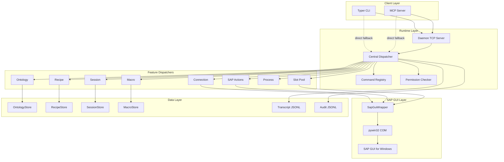
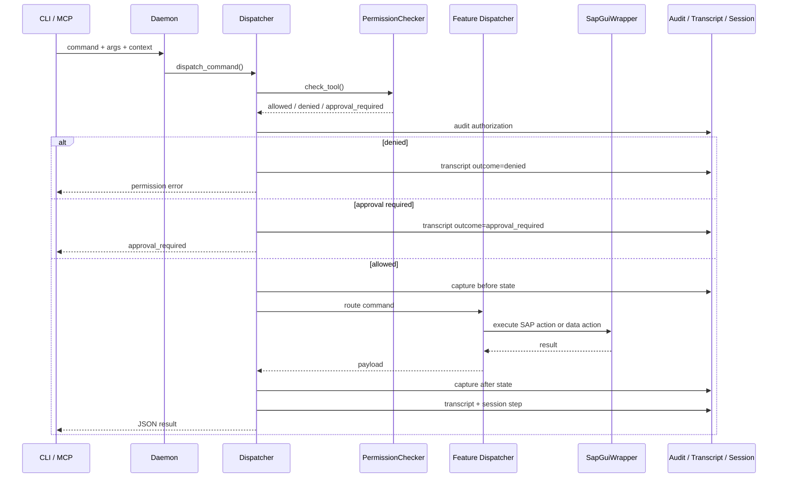
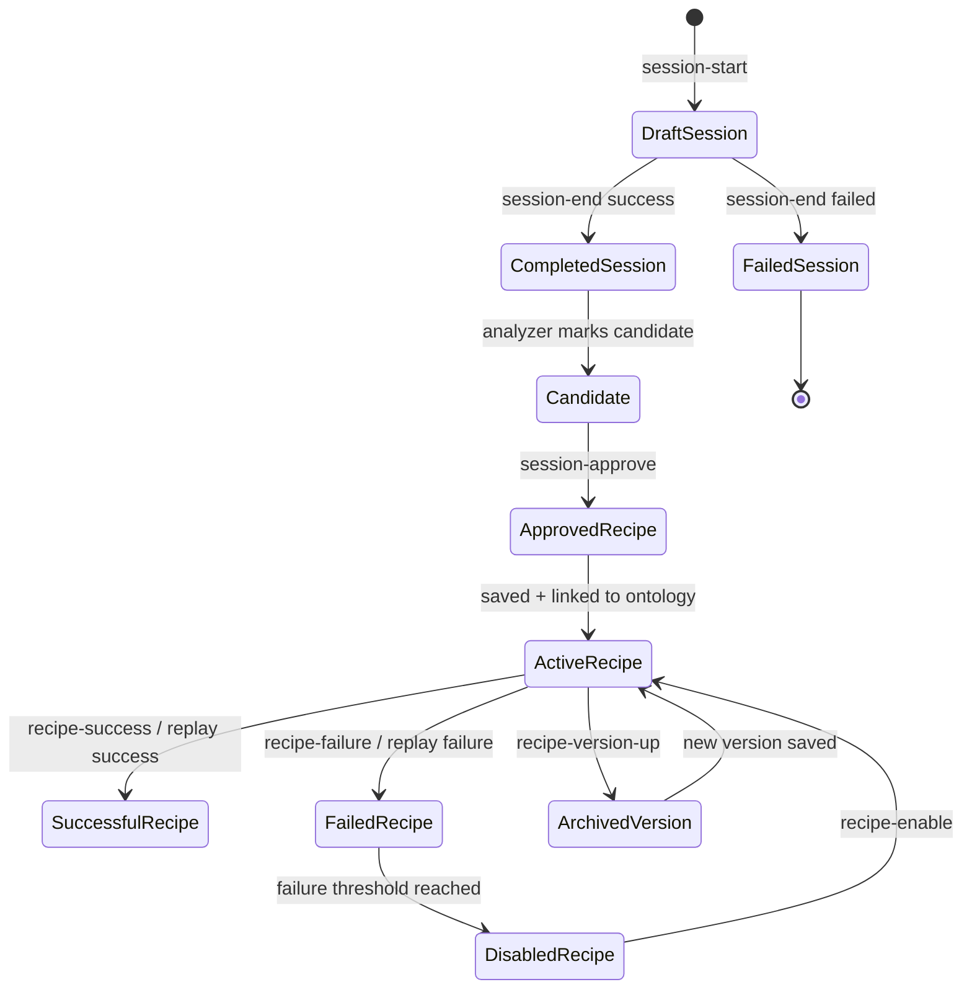
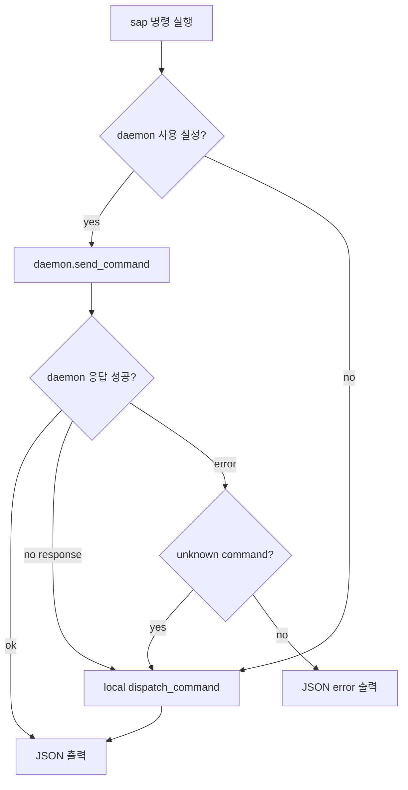
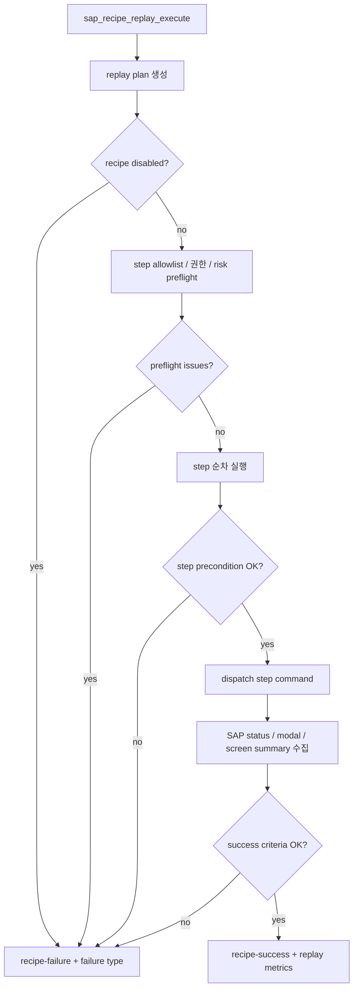

# TRD — SAP CLI

작성 기준: 2026-05-09
분석 대상: `sap_cli` 프로젝트 현재 작업트리
검증 기준: `.venv/bin/python -m pytest -q` 실행 결과 `599 passed`

## 1. 기술 요약

SAP CLI는 Python 기반 CLI/MCP 서버이며, Windows에서는 `pywin32`를 통해 SAP GUI Scripting COM API를 호출한다. 핵심 실행 경로는 `CLI 또는 MCP → daemon 또는 direct dispatch → dispatcher → feature dispatcher → SapGuiWrapper → SAP GUI COM` 구조다.

제품은 SAP GUI 자동화 계층과 지식 축적 계층을 함께 가진다.

- 자동화 계층: connection, screen scan, set/get/fill/press/vkey/table/tree/ui_action
- 지식 계층: ontology, process, recipe, macro, session, transcript
- 운영 계층: ReBAC policy, audit, daemon, data diagnostics, session pool

### 1.1 전체 아키텍처 다이어그램

### 1.2 Dispatcher 실행 시퀀스

## 2. 런타임 환경

### 2.1 Python

- 요구 버전: Python 3.11 이상
- 현재 검증 환경: Python 3.12.11 가상환경

### 2.2 Python 패키지

필수:

- `pydantic>=2.0`
- `typer>=0.9`
- `rich>=13.0`

Windows 한정:

- `pywin32>=306`
- `Pillow>=10.0`

선택:

- `mcp>=1.0`

개발:

- `pytest>=7.0`

### 2.3 OS와 SAP GUI

- 실제 SAP GUI COM 자동화는 Windows 전용이다.
- SAP GUI for Windows 7.70 이상이 전제다.
- `GetObjectTree` 사용에는 SAP GUI 패치 레벨 제약이 있을 수 있다.
- macOS/Linux에서는 단위 테스트, 코드 분석, 문서 작업만 가능하다.

## 3. 패키지 구조

핵심 디렉터리:

- `sap_cli/`: 애플리케이션 코드
- `sap_cli/auth/`: policy, permission checker, audit, transcript logger
- `sap_cli/dispatchers/`: 기능별 command dispatcher
- `sap_cli/macro/`: 매크로 schema/store/recorder/player
- `sap_cli/ontology/`: SAP 업무 온톨로지, 그래프, 프로세스, 질문 응답
- `sap_cli/ontology/knowledge/`: seed transaction/process/pattern/API graph JSON
- `scripts/`: SAP GUI Scripting API graph 빌더
- `skill/`: AI agent용 SAP 사용 skill 문서
- `tests/`: 단위 테스트

주요 루트 문서:

- `README.md`
- `SETUP.md`
- `VERIFICATION.md`
- `WINDOWS_SAP_VERIFICATION.md`
- `DESIGN*.md`
- `TASKS.md`
- `IMPROVEMENT_TASKS.md`

## 4. 코드 규모

현재 Python 코드 총량은 약 21,345 lines다.

주요 대형 모듈:

- `sap_cli/com_wrapper.py`: 약 2,631 lines
- `sap_cli/dispatcher.py`: 약 1,854 lines
- `sap_cli/cli.py`: 약 1,594 lines
- `sap_cli/mcp_server.py`: 약 1,539 lines
- `sap_cli/dispatchers/recipe.py`: 약 1,131 lines
- `sap_cli/ontology/schema.py`: 약 725 lines
- `sap_cli/recipe.py`: 약 725 lines
- `sap_cli/dispatchers/ontology.py`: 약 706 lines

## 5. 주요 컴포넌트

### 5.1 CLI

파일: `sap_cli/cli.py`

역할:

- Typer 기반 `sap` 명령 제공
- 모든 결과 JSON 출력
- daemon 기본 경유
- active CLI session id 파일 관리
- 전역 slot 옵션 처리
- auth/data/daemon/shell/ontology/process/recipe/macro 명령 노출

핵심 함수:

- `_run_command()`: daemon 경유 또는 local dispatch 결정
- `_try_daemon()`: daemon 호출, autostart, stale daemon fallback
- `_cli_context()`: CLI 실행 문맥 생성
- `_daemon_context()`: daemon에 전달할 context 생성

중요 동작:

- `SAP_CLI_USE_DAEMON=0`이면 direct dispatch를 강제한다.
- daemon이 새 명령을 모르면 local dispatch로 fallback한다.
- `session-start` 이후 active session id를 로컬 파일에 저장해 이후 CLI step이 자동 기록되게 한다.

### 5.2 MCP 서버

파일: `sap_cli/mcp_server.py`

역할:

- MCP tool definitions 제공
- MCP tool call을 dispatcher command로 변환
- policy에 따라 visible tool surface 제한
- daemon 기본 경유
- MCP active session id 추적

현재 상태:

- MCP tool definitions: 79개
- command registry의 MCP 노출 command와 일치하도록 테스트로 검증됨

핵심 함수:

- `get_visible_tool_names()`
- `get_visible_tools()`
- `handle_tool()`
- `_dispatch_via_daemon()`

중요 환경변수:

- `SAP_CLI_USE_DAEMON`
- `SAP_CLI_MCP_SCREEN_SUMMARY`
- `SAP_CLI_AGENT`

### 5.3 Daemon

파일: `sap_cli/daemon.py`

역할:

- localhost TCP 서버로 long-running process 제공
- SAP GUI COM 연결 유지
- CLI/MCP 반복 호출의 성능과 안정성 개선

통신:

- host: `127.0.0.1`
- request: JSON line
- response: JSON

핵심 함수:

- `send_command()`
- `is_running()`
- `start_daemon()`
- `stop_daemon()`
- `_DaemonServer.dispatch()`

context 보존:

- `source`
- `tool_name`
- `agent_name`
- `cli_invocation`
- `raw_argv`
- `include_screen_summary`
- `slot_id`
- `session_id`

### 5.4 Dispatcher

파일: `sap_cli/dispatcher.py`

역할:

- 모든 command의 중앙 entrypoint
- 권한 평가
- audit logging
- transcript logging
- session step logging
- feature dispatcher routing
- recipe replay execute 검증

핵심 함수:

- `dispatch_command()`
- `_execute_command()`
- `resolve_mcp_call()`
- `_evaluate_authorization()`
- `_log_transcript()`
- `_log_session_step()`
- `_capture_transcript_state()`

처리 흐름:

1. command 존재 여부 확인
2. command registry에서 tool name 확인
3. policy loading
4. PermissionChecker로 권한 평가
5. audit 기록
6. 필요 시 before state 수집
7. 권한 거부 또는 승인 필요면 transcript 기록 후 예외
8. feature dispatcher 실행
9. after state 수집
10. transcript와 session step 기록
11. 결과 반환

### 5.5 Feature dispatchers

디렉터리: `sap_cli/dispatchers/`

역할:

- `dispatcher.py`의 명령 실행 로직을 기능별로 분리한다.
- 기존 private import 호환을 유지하기 위해 `dispatcher.py`에는 wrapper가 일부 남아 있다.

주요 파일:

- `registry.py`: CommandDef, COMMAND_REGISTRY, MCP mapping
- `connection.py`: connect/connections/session/screen/modal
- `sap_actions.py`: run/set/get/press/vkey/table/tree/ui_action 등
- `form.py`: fill/learn
- `macro.py`: macro record/play/list/show/delete
- `ontology.py`: ontology query/ask/relationship/rebuild/annotate
- `process.py`: process CRUD/status/path
- `recipe.py`: recipe save/search/query/history/quality/replay plan 일부
- `session.py`: session start/end/mark/excel/approve
- `slot.py`: session pool slot commands
- `capture.py`: screenshot capture/list
- `transcript.py`: transcript query/plan
- `post_action.py`: 조작 후 session/status/modal/screen summary 수집

### 5.6 SapGuiWrapper

파일: `sap_cli/com_wrapper.py`

역할:

- SAP GUI Scripting COM API 래핑
- 연결, 화면 스캔, 기본 조작, 고급 컨트롤 조작 제공

주요 책임:

- COM 초기화
- SAP GUI application 획득
- connection/session 선택
- system ID 기반 connection 탐색
- 자동 재연결
- transaction 실행
- command field 입력
- field set/get/focus
- button/tab/menu 조작
- combo entry 조회와 선택
- UI action fallback
- status/modal 조회
- screen ontology 생성
- table/grid/ALV/tree 읽기와 조작
- window action, property, method fallback

지원 컨트롤:

- `GuiTextField`
- `GuiCTextField`
- `GuiPasswordField`
- `GuiComboBox`
- `GuiCheckBox`
- `GuiRadioButton`
- `GuiButton`
- `GuiTab`
- `GuiTableControl`
- `GuiGridView`
- `GuiShell` ALV Grid
- `GuiTree`
- `GuiMainWindow`
- `GuiModalWindow`
- toolbar/context menu/scrollbar 계열

화면 스캔 전략:

1. `GetObjectTree` 시도
2. object tree parsing
3. actionable id 수집
4. 실패 또는 보완 필요 시 manual scan
5. child traversal 중 일부 실패는 skip하고 가능한 요소를 계속 수집

### 5.7 Service layer

파일: `sap_cli/service.py`

역할:

- singleton 성격의 pool/store/learner/recorder/macro store 접근 함수 제공
- dispatcher와 feature dispatcher가 concrete dependency를 직접 만들지 않도록 완충

주요 함수:

- `get_pool()`
- `get_sap()`
- `get_store()`
- `get_learner()`
- `get_recorder()`
- `get_macro_store()`
- `get_session_store()`
- `execute_sap_action()`

## 6. Command registry와 tool surface

파일: `sap_cli/dispatchers/registry.py`

현재 command registry:

- 총 command: 79개
- MCP 노출 command: 79개
- CLI 노출 command: 77개

CommandDef 주요 필드:

- `tool_name`
- `permission`
- `mcp_arg_map`
- `expose_cli`
- `expose_mcp`
- `description`
- `category`
- `risk_level`

권한 레벨:

- `read`
- `execute`
- `write`
- `admin`

대표 command 그룹:

- 연결/화면: `connect`, `connections`, `session`, `screen`, `modal`
- SAP action: `run`, `command`, `set`, `fill`, `get`, `press`, `vkey`, `status`
- 컨트롤: `table`, `tree`, `combo_entries`, `inspect`, `scripting_query`, `ui_action`
- ontology: `ontology_query`, `ontology_ask`, `ontology_rebuild`, `annotate`
- macro: `macro_control`, `record_step`, `macro_play`, `macro_list`, `macro_show`, `macro_delete`
- process: `process_list`, `process_show`, `process_create`, `process_start`, `process_step`, `process_status`
- recipe: `recipe_save`, `recipe_query`, `recipe_replay_plan`, `recipe_replay_execute`, `recipe_history`, `recipe_enable`
- session: `session_start`, `session_mark`, `session_excel`, `session_end`, `session_approve`
- slot: `slots`, `slot_allocate`, `slot_release`
- capture: `capture`, `capture_list`
- transcript: `transcript_query`, `transcript_plan`

드리프트 방지 테스트:

- registry permission과 policy map 일치
- MCP tool definitions와 registry mapping 일치
- MCP 노출 flag와 실제 tool list 일치
- CLI 노출 flag와 Typer command dispatch 일치
- hidden MCP command는 resolve되지 않음

## 7. 데이터 모델

### 7.1 Ontology schema

파일: `sap_cli/ontology/schema.py`

핵심 모델:

- `SapSession`: user, language, transaction, screen_number, system_name, client
- `ScreenOntology`: transaction, screen_number, program, title, fields, tables, trees, buttons, menus, tabs, status
- `SapField`: id, name, type, label, value, changeable, required, max_length, semantic
- `SapTable`: id, name, type, sub_type, row_count, columns, rows
- `SapTreeNode`: key, text, level, items, children, child_count
- `SapButton`: id, name, text, tooltip, icon_name, vkey
- `TransactionOntology`: tcode, title, module, screens, screen_flow, field_dependencies, recipes, action_paths
- `BusinessProcess`: id, name, module, description, steps, data_flows
- `McpSession`: id, started_at, finished_at, status, agent, user_request, steps, outcome, candidate, approved, recipe_id

### 7.2 Recipe schema

파일: `sap_cli/recipe.py`

`RecipeStep` 필드:

- `tool`
- `args`
- `hint`
- `precondition`
- `cli_invocation`
- `raw_argv`
- `step_kind`
- `followable`
- `requires_sap`

`Recipe` 필드:

- identity: `id`, `description`, `context`, `keywords`
- steps: `steps`
- lifecycle: `created_at`, `updated_at`, `version`, `previous_version_archive`
- quality: `success_count`, `failure_count`, `disabled`, `disabled_reason`
- replay metrics: `replay_execution_count`, `replay_average_execution_ms`, `replay_last_status`, `replay_failure_type_counts`
- replay criteria: `replay_success_criteria`
- ownership: `source_session`, `created_by`, `updated_by`, `approved_by`, `shared_scope`, `team`
- indexing: `tcode_sequence`

### 7.2.1 레시피 데이터 생명주기

### 7.3 Macro schema

파일: `sap_cli/macro/schema.py`

핵심 모델:

- `MacroVariable`
- `MacroStep`
- `MacroStepResult`
- `Macro`
- `MacroRunResult`

### 7.4 Auth policy schema

파일: `sap_cli/auth/policy.py`

핵심 모델:

- `Permission`: read/execute/write/admin
- `Relation`: viewer/operator/supervisor/owner
- `AgentPolicy`
- `ApprovalRule`
- `DangerousTransaction`
- `DangerousReport`
- `AuditConfig`
- `TranscriptConfig`
- `SessionConfig`
- `Policy`

## 8. 저장소와 파일 안정성

### 8.1 공통 storage 유틸

파일: `sap_cli/storage.py`

제공 함수:

- `atomic_write_text()`
- `atomic_write_json()`
- `fsync_dir_best_effort()`
- `safe_read_json()`

보장:

- temp 파일에 먼저 기록
- flush/fsync 후 replace
- short write retry
- 실패 시 temp cleanup
- 기존 파일 보존
- Windows/POSIX 차이를 best effort로 처리

### 8.2 저장소별 적용

적용 대상:

- `RecipeStore`
- `MacroStore`
- `SessionStore`
- `OntologyStore`

append 기반:

- audit log
- transcript log

보안:

- id validation으로 path traversal 차단
- archive load에도 경로 검증 적용

## 9. 온톨로지 기술 설계

### 9.1 OntologyStore

파일: `sap_cli/ontology/store.py`

역할:

- transaction JSON CRUD
- screen JSON 저장/조회
- pattern 저장/조회
- process 저장/조회
- field registry 저장
- field dependency graph 저장
- document flow 저장
- meta edge registry 저장
- seed data 복사

기본 seed 위치:

- `sap_cli/ontology/knowledge/transactions/`
- `sap_cli/ontology/knowledge/processes/`
- `sap_cli/ontology/knowledge/patterns/`
- `sap_cli/ontology/knowledge/scripting_api/`

### 9.2 OntologyGraph

파일: `sap_cli/ontology/graph.py`

역할:

- store 기반 그래프 생성
- transaction/screen/field 노드 구성
- field registry, dependencies, document flow edge 추가
- path 탐색과 related transaction 조회

### 9.3 Natural language Q&A

파일:

- `sap_cli/ontology/question_parser.py`
- `sap_cli/ontology/answer_formatter.py`
- `sap_cli/ontology/semantic_search.py`

지원 질문 유형:

- 트랜잭션 요약
- 필수 필드
- 필드 의미
- 필드가 어디서 쓰이는지
- 필드 의존성
- 업무 프로세스
- 공통 패턴

검색 방식:

- 정규화
- token overlap
- substring score
- SAP field name, label, synonyms, domain context 기반 matching

## 10. Recipe 기술 설계

### 10.1 RecipeStore

파일: `sap_cli/recipe.py`

기능:

- save/load/delete/list
- search
- success/failure count update
- auto disable 판단
- replay execution metric 기록
- success criteria update
- version up
- archive load/history
- enable
- chain search
- AI query
- similarity search

자동 비활성화:

- 실패 누적이 일정 기준 이상이고 실패율이 높으면 disabled 처리할 수 있다.

### 10.2 Hybrid retrieval

파일: `sap_cli/recipe_retrieval.py`

구성:

- query builder
- recipe document builder
- tokenization
- document frequency
- BM25
- semantic overlap
- tcode score
- step_kind score
- quality score
- match reasons
- matched snippets

검색 결과 모델:

- `RecipeSearchResult`

반환 정보:

- recipe
- relevance score
- quality score
- metadata
- retrieval details

### 10.3 Session to recipe

파일: `sap_cli/session_analyzer.py`

처리:

- exploration step marking
- recovery step marking
- retry 제거
- core flow 추출
- candidate 판단
- args generalization
- tcode/keywords 추출
- safe recipe id 생성
- replay success criteria 추론
- recipe 변환
- approval 처리

Candidate 조건:

- 성공 종료
- core step 수 충분
- tcode 포함
- exploration/recovery 제외 후 유효 흐름 존재

### 10.4 Replay execution

주요 위치: `sap_cli/dispatcher.py`, `sap_cli/dispatchers/recipe.py`

Plan 단계:

- recipe load
- disabled 확인
- 시작 tcode/screen precheck
- execution plan 생성
- step preconditions 노출
- success criteria 노출

Execute 단계:

- replay plan 생성
- preflight로 step allowlist/권한/승인/risk 확인
- step별 precondition 확인
- command 실행
- 실행 후 observation 수집
- success criteria 검증
- success/failure 자동 report
- replay metrics 기록

허용 step 원칙:

- SAP action/form/read 중심 step만 허용
- recipe 관리/삭제/버전업 같은 meta operation은 replay execute에서 차단

## 11. Session pool 기술 설계

파일: `sap_cli/session_pool.py`

주요 모델:

- `SessionSlot`
- `SessionPool`

기능:

- slot 생성/조회/해제/종료
- max session 제한
- TTL 기반 expired slot sweep
- thread-safe create
- SAP GUI create_session 연동
- agent assignment
- slot connection metadata update

Slot id validation:

- 빈 값 금지
- 공백 금지
- 특수문자 제한
- 길이 제한

## 12. Auth/ReBAC 기술 설계

파일:

- `sap_cli/auth/policy.py`
- `sap_cli/auth/checker.py`
- `sap_cli/auth/audit.py`
- `sap_cli/auth/default_policy.yaml`

정책 로딩:

- 기본 policy path는 사용자 홈의 `.sap_cli/policy.yaml` 계열이다.
- 정책이 없으면 allow_all 모드로 동작한다.

권한 평가:

1. tool name으로 permission 확인
2. arguments에서 transaction/report/resource 추출
3. agent relation 기반 권한 확인
4. dangerous transaction/report rule 확인
5. approval_required 또는 deny 적용
6. risk metadata 반환

tool surface 제한:

- enforcing 모드에서는 agent가 접근 가능한 MCP tool만 노출한다.
- viewer/verifier는 read 중심 tool만 볼 수 있다.
- operator는 read/execute/write를 볼 수 있지만 admin은 숨겨진다.

Audit:

- JSONL 형태
- allowed/denied/approval_required 기록
- 민감 argument sanitization

## 13. Transcript 기술 설계

파일:

- `sap_cli/auth/transcript.py`
- `sap_cli/transcript_store.py`
- `sap_cli/transcript_planner.py`

TranscriptLogger:

- policy의 transcript 설정 기반 활성화
- read 포함 여부 설정
- screen summary 포함 여부 설정
- payload sanitization

TranscriptStore:

- JSONL log query
- outcome/command/tool/agent/text 필터
- full 또는 summary 반환

TranscriptPlanner:

- selected entry 요약
- risk level 계산
- replayable 판단
- why/preconditions/suggested checks/proposed sequence 생성
- CLI command 재구성
- ontology context 구성

## 14. Macro 기술 설계

파일:

- `sap_cli/macro/recorder.py`
- `sap_cli/macro/player.py`
- `sap_cli/macro/store.py`
- `sap_cli/macro/schema.py`

Recorder:

- start/record_step/undo/finish/cancel/status
- state file 저장
- variable 자동 감지
- tcode 자동 추론
- 변수명 normalization

Player:

- variable resolution
- dry-run
- step execution
- expected screen 검증
- tree action 실행
- current screen 조회

Store:

- id validation
- atomic save
- list/load/delete
- tcode/name search

## 15. 화면 캡처 기술 설계

파일: `sap_cli/screenshot.py`

역할:

- SAP GUI window handle 탐색
- window rect 계산
- Pillow/ImageGrab 기반 캡처
- step/tcode/screen 기반 기본 경로 생성
- 캡처 목록 조회

제약:

- Windows GUI 세션이 잠기거나 최소화되면 캡처 실패 가능
- macOS/Linux에서는 실제 SAP GUI 캡처 불가

## 16. Data diagnostics 기술 설계

파일: `sap_cli/data_diagnostics.py`

기능:

- 기본 데이터 디렉터리 산출
- policy path 산출
- 데이터 위치 조회
- 파일 count/size/mtime 상태 조회
- zip/tar backup 생성
- 오래된 로그 dry-run/apply clean
- 빈 디렉터리 cleanup

대상 카테고리:

- recipes
- macros
- ontology
- sessions
- transcripts
- audit
- screenshots
- policy

## 17. 주요 실행 시퀀스

### 17.1 CLI direct/daemon 실행

1. 사용자가 `sap run MM03` 실행
2. Typer command가 `_run_command("run", args)` 호출
3. daemon 기본값이면 `_try_daemon()` 호출
4. daemon이 응답하면 JSON 출력
5. daemon이 없거나 stale이면 local `dispatch_command()` 실행
6. dispatcher가 권한/감사/transcript 처리
7. `sap_actions.dispatch_run()` 실행
8. `SapGuiWrapper.run_transaction()` 호출
9. post action으로 session/status/modal 수집
10. JSON 출력

#### 17.1.1 CLI 실행 흐름 다이어그램

### 17.2 MCP tool 실행

1. MCP client가 `sap_run` tool 호출
2. `handle_tool()`이 visible tool 여부 확인
3. `resolve_mcp_call()`로 dispatcher command 변환
4. daemon 사용 설정이면 daemon에 context 포함 요청
5. daemon dispatch 또는 direct dispatch 실행
6. active MCP session id 갱신
7. JSON text content 반환

### 17.3 세션에서 레시피 생성

1. `sap session-start "작업 목표"`
2. 이후 SAP 명령이 session step으로 자동 기록
3. 필요 시 `session-mark`, `session-excel`로 비SAP step 기록
4. `session-end --outcome success`
5. session analyzer가 candidate 여부 판단
6. supervisor가 `session-approve` 실행
7. recipe 저장
8. ontology action path에 recipe link 생성

### 17.4 Recipe replay execute

1. CLI `sap recipe-replay-execute` 또는 MCP `sap_recipe_replay_execute` 호출
2. replay plan 생성
3. disabled/start condition 확인
4. step preflight로 권한/승인/risk 검사
5. step별 precondition 확인
6. 허용된 step만 순차 실행
7. SAP status/modal/screen summary observation 수집
8. success criteria 검증
9. 성공이면 recipe success와 replay metric 기록
10. 실패이면 recipe failure와 failure type 기록

#### 17.4.1 Recipe replay 검증 흐름

## 18. 테스트 현황

현재 테스트:

- 599 tests collected
- 599 passed
- 실행 시간: 약 0.89초

검증 영역:

- SAP connection stability와 reconnect
- ALV/Grid/Table/Tree 조작
- ComboBox와 UI action fallback
- Command registry와 MCP/CLI surface consistency
- ReBAC 권한, dangerous transaction/report, audit
- MCP daemon delegation과 fallback
- Ontology store, graph, Q&A, semantic search
- Process executor
- Recipe query, quality, versioning, replay plan/execute
- Session analyzer, session store, session pool
- Macro store, recorder, player
- Storage atomic write
- Transcript store/planner
- Data diagnostics

실기 검증:

- `WINDOWS_SAP_VERIFICATION.md`에 Windows + SAP GUI COM 환경 체크리스트가 존재한다.
- 자동 테스트는 COM mock 중심이므로 실제 SAP GUI 제어는 Windows 실기 검증이 필요하다.

## 19. 주요 리스크와 대응

### 19.1 Windows/SAP GUI 환경 의존성

리스크:

- macOS/Linux에서 실제 SAP GUI COM 실행 불가
- SAP GUI patch/theme/custom control에 따라 element 접근 차이 발생

대응:

- Windows 실기 검증 체크리스트 유지
- manual scan fallback
- inspect/scripting-query/ui_action fallback 제공

### 19.2 운영 위험 트랜잭션

리스크:

- AI가 변경성/관리성 transaction을 실행할 수 있음

대응:

- ReBAC policy
- dangerous transaction/report preflight
- approval_required outcome
- audit/transcript logging

### 19.3 레시피 부정확성

리스크:

- SAP 화면 변경 후 기존 recipe가 실패할 수 있음

대응:

- replay precheck
- step precondition
- success criteria
- failure count와 auto disable
- version up과 history

### 19.4 데이터 민감성

리스크:

- transcript, screenshot, audit에 업무 민감정보가 저장될 수 있음

대응:

- argument sanitization
- 운영 환경 저장 정책 필요
- 공유 전 마스킹 필요
- data clean/backup 제공

### 19.5 장기 daemon stale 문제

리스크:

- 코드 업데이트 후 오래된 daemon이 새 command를 모를 수 있음

대응:

- unknown command 감지 시 direct dispatch fallback
- daemon status/stop/start 명령 제공

## 20. 개선 권장사항

1. `dispatcher.py`에 남아 있는 recipe replay execute와 wrapper 계층 추가 분리
2. MCP 설치 의존성 없는 환경에서의 안내 메시지 개선
3. recipe replay execute CLI 노출 기능의 Windows SAP 실기 검증
4. Windows 실기 검증 결과를 자동 테스트 fixture로 일부 환류
5. SAP GUI Scripting generated graph 생성/검증 명령을 CLI에 더 명확히 노출
6. transcript/screenshot 민감정보 마스킹 정책 강화
7. recipe 품질과 실패 원인 요약 command 추가
