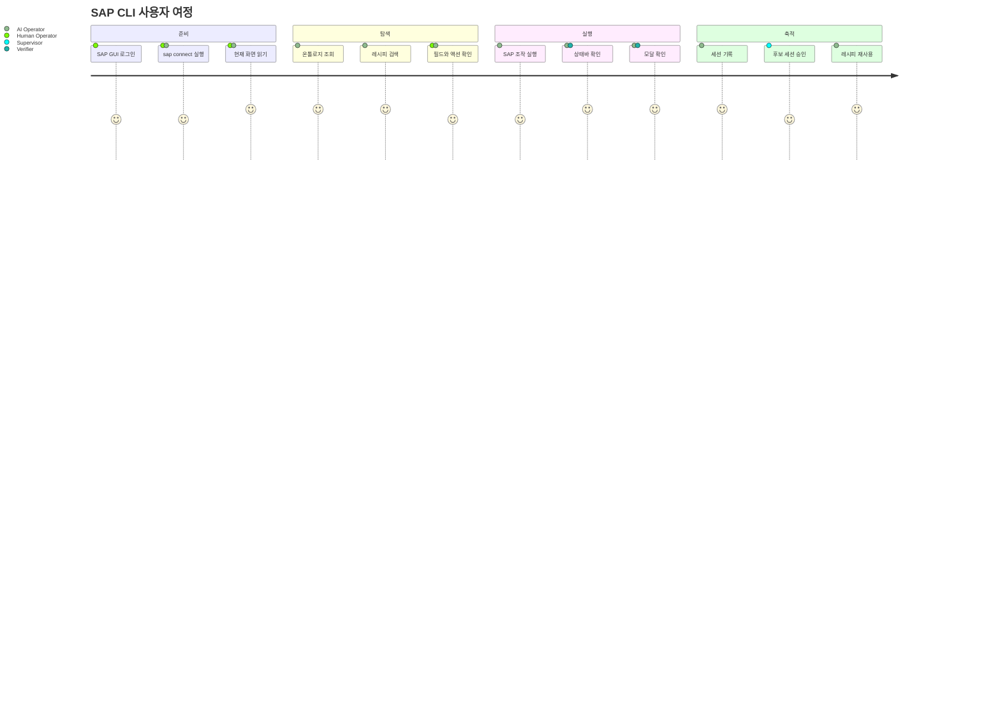
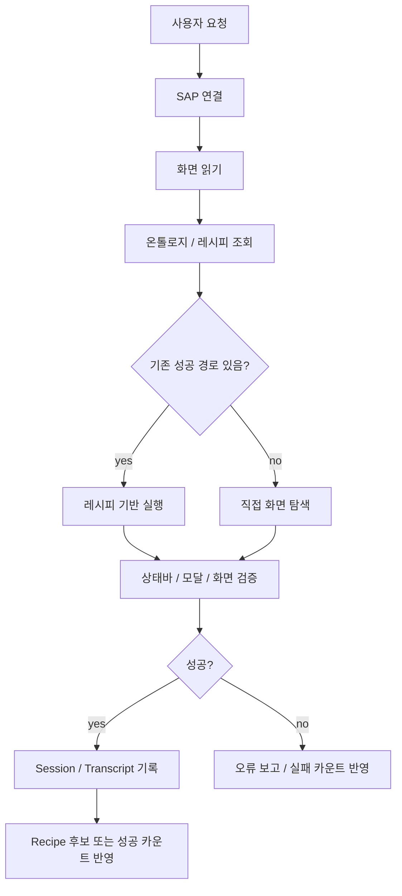
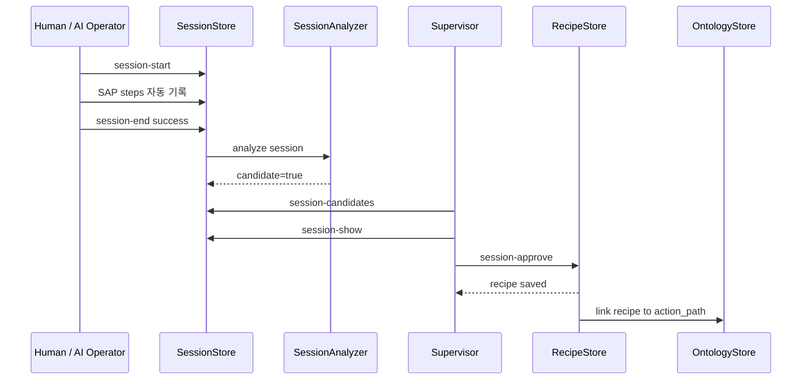
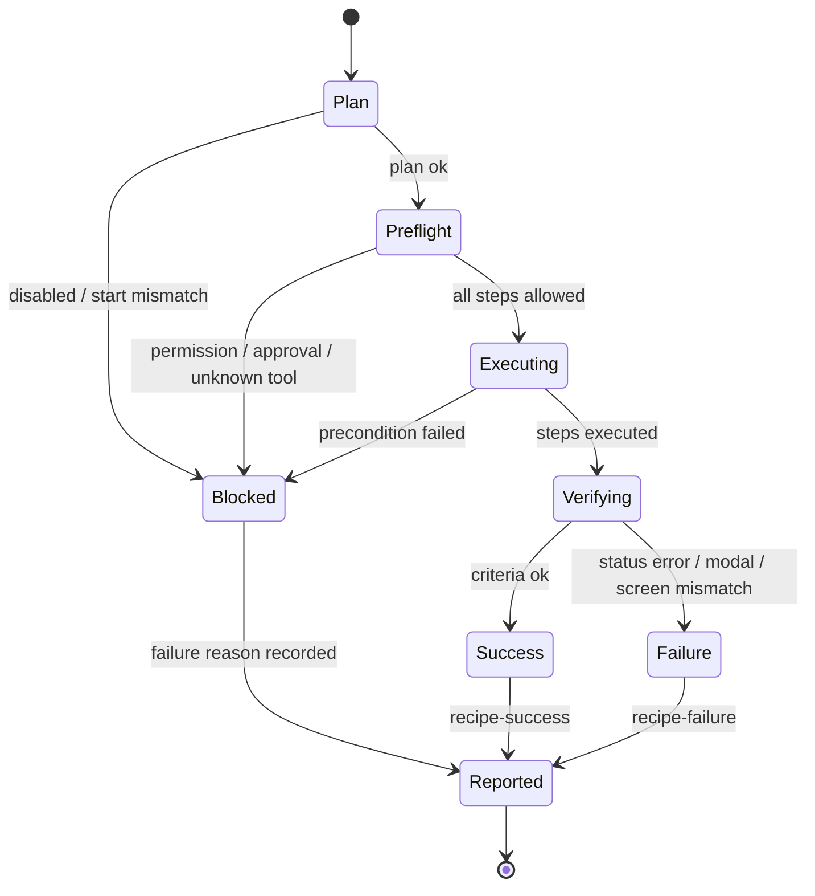
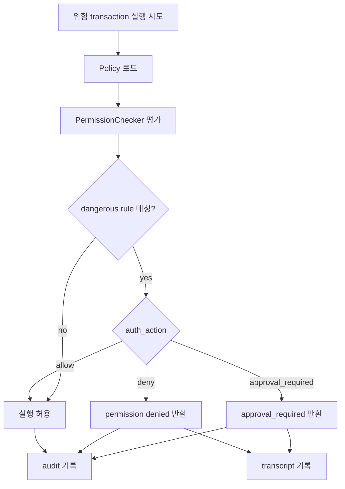

# 유저 시나리오 — SAP CLI

작성 기준: 2026-05-09
분석 대상: `sap_cli` 프로젝트 현재 작업트리
검증 기준: `.venv/bin/python -m pytest -q` 실행 결과 `599 passed`

## 1. 공통 전제

### 1.1 실행 환경

- Windows PC에서 SAP GUI for Windows가 실행 중이다.
- SAP GUI에 사용자가 로그인되어 있다.
- SAP GUI Scripting이 서버와 클라이언트 모두에서 활성화되어 있다.
- `sap-cli`가 가상환경에 설치되어 있다.
- CLI 또는 MCP client가 `sap` 명령 또는 `sap_*` tool을 호출할 수 있다.

### 1.2 안전 원칙

모든 시나리오는 다음 원칙을 따른다.

1. 연결한다.
2. 화면을 읽는다.
3. 가능한 기존 온톨로지/레시피를 먼저 조회한다.
4. 조작한다.
5. 상태바와 모달을 확인한다.
6. 실패 또는 경고가 있으면 임의 반복하지 않고 transcript/화면/상태를 재검토한다.
7. 성공한 경로만 레시피 후보로 남긴다.

### 1.3 전체 사용자 여정 다이어그램

### 1.4 공통 작업 흐름 다이어그램

## 2. 페르소나

### 2.1 AI Operator

사용자 요청을 받아 SAP GUI를 조작하는 AI 에이전트다.

목표:

- SAP 화면을 직접 추측하지 않고 구조화된 정보로 판단한다.
- 반복 업무는 기존 recipe를 먼저 활용한다.
- 작업 결과를 status/modal/screen으로 검증한다.

### 2.2 Human Operator

터미널에서 직접 `sap` CLI를 실행하는 사람이다.

목표:

- SAP 화면을 빠르게 조회하고 조작한다.
- 성공한 업무 순서를 session/recipe로 남긴다.
- 매크로를 기록하고 재생한다.

### 2.3 Supervisor

레시피와 권한을 관리하는 책임자다.

목표:

- 위험 transaction을 승인 기반으로 통제한다.
- 후보 세션을 검토해 recipe로 승인한다.
- 실패 recipe를 비활성화하거나 버전업한다.

### 2.4 Verifier

작업 후 결과를 확인하는 검증자다.

목표:

- 읽기 전용 tool로 상태를 검증한다.
- transcript 기반으로 재실행 위험을 평가한다.

## 3. 시나리오 1 — 최초 연결과 현재 화면 파악

### 목적

SAP GUI에 연결하고 현재 세션과 화면 구조를 확인한다.

### 사용자

Human Operator 또는 AI Operator

### 사전 조건

- SAP GUI가 실행 중이다.
- 최소 1개 SAP 세션이 로그인되어 있다.

### 흐름

1. 사용자가 연결 명령을 실행한다.
   - CLI: `sap connect`
   - MCP: `sap_connect`
2. 시스템은 연결 결과와 세션 정보를 JSON으로 반환한다.
3. 사용자가 세션 정보를 조회한다.
   - CLI: `sap session`
   - MCP: `sap_session`
4. 사용자가 현재 화면을 조회한다.
   - CLI: `sap screen`
   - MCP: `sap_screen`
5. 필요한 경우 입력 필드만 조회한다.
   - CLI: `sap screen --fields-only`
6. 필요한 경우 액션만 조회한다.
   - CLI: `sap screen --actions-only`

### 성공 기준

- `connected=true`에 준하는 연결 결과가 반환된다.
- transaction과 screen number를 확인할 수 있다.
- fields/buttons/tables/trees 중 현재 화면에 존재하는 요소가 JSON으로 반환된다.

### 예외 흐름

- SAP GUI가 실행 중이 아니면 연결 실패 메시지를 반환한다.
- SAP GUI Scripting이 꺼져 있으면 COM 접근 오류가 발생한다.
- 여러 SAP system에 로그인되어 있으면 `sap connections`로 목록을 보고 `sap connect --system <SID>`를 사용한다.

## 4. 시나리오 2 — MM03 자재 조회

### 목적

자재번호를 입력해 MM03에서 자재 마스터를 조회한다.

### 사용자

Human Operator 또는 AI Operator

### 사전 조건

- 조회 가능한 자재번호가 있다.
- 사용자가 MM03 권한을 가진다.

### 흐름

1. SAP에 연결한다.
   - `sap connect`
2. 기존 지식을 조회한다.
   - `sap ontology MM03`
   - MCP에서는 `sap_ontology_query(tcode="MM03")`
3. MM03을 실행한다.
   - `sap run MM03`
4. 화면 필드를 확인한다.
   - `sap screen --fields-only`
5. 자재번호를 입력한다.
   - `sap fill MATNR=100-100`
6. 상태바를 확인한다.
   - `sap status`
7. 모달이 있는지 확인한다.
   - `sap modal`
8. 다음 화면으로 넘어갔다면 다시 화면을 읽는다.
   - `sap screen`
9. 필요한 필드를 검색한다.
   - `sap screen --search "MAKTX"`
10. 값을 읽는다.
   - `sap get <element_id>`

### 성공 기준

- MM03 화면으로 이동한다.
- MATNR 필드가 확인된다.
- 자재번호 입력 후 상태바가 오류를 표시하지 않는다.
- 조회 결과 화면에서 필요한 필드를 읽을 수 있다.

### 예외 흐름

- 자재번호가 없으면 status type `E`가 반환된다.
- view 선택 팝업이 뜨면 `sap screen --fields-only`, `sap table-select`, `sap vkey 0` 순서로 처리한다.
- MATNR alias가 매핑되지 않으면 `sap screen --search "MATNR"`로 실제 element id를 찾은 뒤 `sap set`을 사용한다.

## 5. 시나리오 3 — AI가 기존 레시피를 먼저 찾고 실행 계획을 참고

### 목적

AI가 복잡한 SAP 네비게이션을 직접 탐색하기 전에 기존 성공 경로를 검색한다.

### 사용자

AI Operator

### 사전 조건

- 저장된 recipe가 하나 이상 있다.
- 사용자가 유사한 SAP 작업을 요청한다.

### 흐름

1. AI가 사용자 요청에서 tcode와 키워드를 추출한다.
2. AI가 recipe를 검색한다.
   - CLI: `sap recipe-query --tcode SPRO --keywords "가격결정"`
   - MCP: `sap_recipe_query`
3. 시스템은 hybrid ranking 결과를 반환한다.
4. AI는 `retrieval.match_reasons`, `matched_snippets`, `quality_score`, `relevance_score`를 확인한다.
5. 결과가 하나면 execution plan을 검토한다.
6. 결과가 여러 개면 `sap recipe-show <recipe_id>`로 상세 단계를 확인한다.
7. AI는 현재 SAP 화면과 recipe 시작 조건이 맞는지 확인한다.
8. AI는 step을 하나씩 실행하고 매 step 후 status/modal/screen을 확인한다.
9. 성공하면 `sap recipe-success <recipe_id>`를 호출한다.
10. 실패하면 `sap recipe-failure <recipe_id> --reason "<사유>"`를 호출한다.

### 성공 기준

- 유사 recipe가 검색된다.
- AI가 recipe step을 실행 가능한 계획으로 변환한다.
- 완료 후 success/failure가 품질 메트릭에 반영된다.

### 예외 흐름

- 검색 결과가 없으면 AI가 직접 화면 탐색을 수행하고 성공 시 session/recipe로 남긴다.
- recipe가 현재 화면과 맞지 않으면 recipe를 무리하게 실행하지 않는다.
- 반복 실패 recipe는 자동 비활성화될 수 있다.

## 6. 시나리오 4 — 세션 기록 후 레시피 후보 생성

### 목적

터미널에서 수행한 SAP 작업을 AI 재사용 가능한 recipe 후보로 남긴다.

### 사용자

Human Operator 또는 AI Operator

### 사전 조건

- SAP GUI 연결 가능
- 수행할 업무 목표가 명확함

### 흐름

1. 작업 세션을 시작한다.
   - `sap session-start "MM03 자재 조회 성공 경로"`
2. SAP에 연결한다.
   - `sap connect --system PR1`
3. 필요한 SAP 명령을 실행한다.
   - `sap run MM03`
   - `sap screen --fields-only`
   - `sap fill MATNR=100-100`
   - `sap status`
4. SAP 외부 준비 작업이 있으면 marker를 남긴다.
   - `sap session-mark "입력 CSV 생성" --kind bash --cli "python scripts/prepare_input.py" --no-requires-sap`
5. Excel 관련 단계가 있으면 excel marker를 남긴다.
   - `sap session-excel "업로드 대상 범위 확인" --action check --workbook input.xlsx --sheet Sheet1 --range A1:D20`
6. 작업이 끝나면 세션을 종료한다.
   - `sap session-end --outcome success --summary "MM03 조회 성공"`
7. 시스템은 세션을 분석해 candidate 여부를 판단한다.
8. 필요 시 candidate 목록을 조회한다.
   - `sap recipe-pending`
   - `sap session-candidates`

### 성공 기준

- session JSON에 step이 기록된다.
- CLI invocation과 raw argv가 보존된다.
- 성공 세션이 recipe candidate로 표시된다.

### 예외 흐름

- 실패한 세션은 candidate가 되지 않는다.
- exploration step과 recovery step은 recipe core flow에서 제외된다.
- core step이 너무 적거나 tcode가 없으면 candidate가 되지 않는다.

## 7. 시나리오 5 — Supervisor가 후보 세션을 레시피로 승인

### 목적

검증된 성공 세션을 공식 recipe로 전환한다.

### 사용자

Supervisor

### 사전 조건

- candidate session이 존재한다.
- Supervisor가 admin 권한을 가진다.

### 흐름

1. 후보 목록을 조회한다.
   - `sap session-candidates`
2. 후보 상세를 확인한다.
   - `sap session-show <session_id>`
3. step 중 exploration/recovery가 잘 제거되었는지 확인한다.
4. replay success criteria가 적절한지 확인한다.
5. 후보를 승인한다.
   - `sap session-approve <session_id>`
6. 시스템은 session을 recipe로 변환해 저장한다.
7. 시스템은 관련 ontology action path에 recipe를 연결한다.
8. 이후 `sap recipe-query`에서 해당 recipe가 검색된다.

### 성공 기준

- recipe 파일이 생성된다.
- source_session, approved_by, tcode_sequence 등 메타데이터가 기록된다.
- ontology에서 관련 action path를 통해 recipe를 참조할 수 있다.

### 승인 흐름 다이어그램

### 예외 흐름

- candidate가 아닌 session은 승인 거부된다.
- 이미 승인된 session은 중복 승인되지 않는다.
- replay success criteria를 명시적으로 override할 수 있다.

## 8. 시나리오 6 — Recipe replay plan으로 사전 검증

### 목적

recipe를 실제 실행하기 전에 현재 SAP 상태와 위험 요소를 검토한다.

### 사용자

AI Operator 또는 Verifier

### 사전 조건

- recipe가 존재한다.
- MCP 사용 가능

### 흐름

1. recipe 상세를 확인한다.
   - `sap_recipe_show(recipe_id="...")`
2. replay plan을 생성한다.
   - CLI: `sap recipe-replay-plan "..."`
   - MCP: `sap_recipe_replay_plan(recipe_id="...")`
3. 시스템은 precheck 결과를 반환한다.
4. 사용자는 현재 tcode/screen과 recipe 시작 조건이 맞는지 확인한다.
5. 사용자는 dry-run plan과 step preconditions를 확인한다.
6. success criteria를 확인한다.
7. 문제가 없으면 replay execute 또는 수동 step 실행을 선택한다.

### 성공 기준

- plan에 precheck, dry_run_plan, verify/report 흐름이 표시된다.
- disabled recipe는 차단된다.
- 시작 화면 불일치가 이슈로 표시된다.

### 예외 흐름

- 현재 화면이 recipe 시작 조건과 다르면 실행하지 않는다.
- recipe가 disabled면 명시적 옵션 없이 실행하지 않는다.
- success criteria가 없으면 기본 검증 기준을 사용한다.

## 9. 시나리오 7 — Recipe replay execute로 자동 실행

### 목적

검증 가능한 recipe를 실제로 실행하고 성공/실패를 자동 기록한다.

### 사용자

AI Operator

### 사전 조건

- CLI 또는 MCP에서 recipe replay execute를 사용할 수 있다.
- 현재 SAP 화면이 recipe 시작 조건에 맞는다.
- policy상 step 실행 권한이 있다.

### 흐름

1. AI가 replay execute를 호출한다.
   - CLI: `sap recipe-replay-execute "..."`
   - MCP: `sap_recipe_replay_execute(recipe_id="...")`
2. 시스템은 replay plan을 생성한다.
3. 시스템은 step allowlist를 확인한다.
4. 시스템은 각 step의 permission, approval_required, risk metadata를 확인한다.
5. 시스템은 step별 precondition을 실행 직전 확인한다.
6. 허용된 step만 순서대로 실행한다.
7. 실행 후 SAP session/status/modal/screen summary를 수집한다.
8. success criteria로 결과를 검증한다.
9. 성공하면 recipe success와 replay metrics를 기록한다.
10. 실패하면 recipe failure와 failure type을 기록한다.

### 성공 기준

- 최종 status가 성공이다.
- 예상 tcode/screen/title 조건이 충족된다.
- 예상치 못한 modal이 남아 있지 않다.
- replay_execution_count와 평균 실행 시간이 갱신된다.

### 예외 흐름

- 허용되지 않은 tool step이 있으면 preflight에서 blocked 된다.
- 위험 transaction/report가 있으면 approval_required 또는 deny 된다.
- step precondition이 틀리면 실행을 중단한다.
- status type `E` 또는 `A`가 나오면 실패로 기록한다.

### Replay 실행 상태 다이어그램

## 10. 시나리오 8 — 콤보박스/테이블/트리 같은 복잡 컨트롤 조작

### 목적

전용 명령만으로 처리하기 어려운 SAP GUI 컨트롤을 live capability 기반으로 조작한다.

### 사용자

AI Operator 또는 Human Operator

### 사전 조건

- 현재 화면에 ComboBox, ALV Grid, TableControl, Tree 중 하나가 있다.

### 흐름

1. 화면을 읽어 element id를 찾는다.
   - `sap screen`
2. 단일 요소를 검사한다.
   - `sap inspect <element_id>`
3. API graph를 조회한다.
   - `sap scripting-query --type GuiComboBox --intent select`
4. 콤보박스이면 entries를 확인한다.
   - `sap combo-entries <element_id>`
5. 범용 액션으로 조작한다.
   - `sap act <element_id> set "Standard Delivery"`
6. 테이블이면 읽기 또는 셀 조작을 수행한다.
   - `sap table <element_id>`
   - `sap act <element_id> read_cell --row 0 --column MATNR`
7. 트리이면 노드 키를 읽고 조작한다.
   - `sap tree <tree_id> --depth 1`
   - `sap tree-expand <tree_id> <node_key>`
   - `sap tree-doubleclick <tree_id> <node_key>`
8. 조작 후 상태와 화면을 재확인한다.
   - `sap status`
   - `sap screen`

### 성공 기준

- live Type/SubType과 capability가 확인된다.
- display value가 combo key로 매핑되어 선택된다.
- table/grid/tree 데이터가 JSON으로 반환된다.
- 조작 후 화면 상태가 기대대로 변경된다.

### 예외 흐름

- unsupported shell subtype이면 명확한 오류를 반환한다.
- 닫힌 tree node는 expand 후 다시 읽어야 한다.
- ALV 데이터가 많으면 max rows 제한을 적용한다.

## 11. 시나리오 9 — 위험 트랜잭션 승인 요구

### 목적

AI 또는 사용자가 위험 transaction을 실행할 때 policy가 승인 요구로 차단한다.

### 사용자

AI Operator, Supervisor

### 사전 조건

- policy가 enforcing 모드다.
- active agent가 위험 transaction에 대해 approval_required rule을 가진다.

### 흐름

1. 사용자가 위험 transaction 실행을 시도한다.
   - `sap run SM30`
2. dispatcher가 tool permission과 resource를 계산한다.
3. PermissionChecker가 dangerous transaction rule을 찾는다.
4. 시스템은 실행하지 않고 approval_required 결과를 반환한다.
5. audit log에 approval_required가 기록된다.
6. transcript에도 approval_required outcome이 기록된다.
7. Supervisor가 별도 절차로 승인하거나 수동 처리한다.

### 성공 기준

- SM30이 실제로 실행되지 않는다.
- JSON 결과에 approval_required와 reason이 포함된다.
- audit/transcript에 기록된다.

### 예외 흐름

- policy가 없으면 allow_all 모드이므로 운영에서는 policy 설정이 필수다.
- deny rule이면 approval이 아니라 권한 거부로 처리된다.

### 위험 작업 승인 흐름 다이어그램

## 12. 시나리오 10 — Verifier가 transcript 기반으로 재실행 검토

### 목적

실행된 step을 다시 수행해도 안전한지 검토한다.

### 사용자

Verifier

### 사전 조건

- transcript log가 존재한다.
- verifier profile은 read 중심 도구만 접근 가능하다.

### 흐름

1. 최근 transcript를 조회한다.
   - `sap transcript --limit 10`
   - MCP: `sap_transcript_query`
2. 특정 command 또는 outcome으로 필터링한다.
   - `sap transcript --outcome approval_required`
   - `sap transcript --command set`
3. 재실행 검토 계획을 생성한다.
   - `sap transcript-plan --command set --index 0`
4. 시스템은 risk level, replayable 여부, before/after state를 반환한다.
5. 시스템은 권장 확인 순서를 제공한다.
6. Verifier는 `sap session`, `sap status`, `sap modal`, `sap screen --fields-only`로 현재 상태를 확인한다.
7. 재실행이 위험하면 중단하고 사용자에게 보고한다.

### 성공 기준

- 재실행 전 확인 조건이 명확하다.
- 저장/변경성 step은 더 높은 risk로 표시된다.
- approval_required entry는 non-replayable로 표시된다.

### 예외 흐름

- transcript가 없으면 조회 결과가 비어 있다.
- 현재 화면이 before state와 다르면 재실행하지 않는다.

## 13. 시나리오 11 — 매크로 기록과 재생

### 목적

반복 SAP 조회 작업을 매크로로 저장하고 변수만 바꿔 재실행한다.

### 사용자

Human Operator

### 사전 조건

- 반복할 SAP 작업이 조회 중심이다.
- 실제 저장/변경 작업은 운영 정책상 승인 없이 매크로화하지 않는다.

### 흐름

1. 매크로 기록을 시작한다.
   - `sap record-start mm03_smoke`
2. step을 기록하며 실행한다.
   - `sap record-step run MM03`
   - `sap record-step set MATNR 100-100`
   - `sap record-step vkey 0`
3. 필요 시 마지막 step을 취소한다.
   - `sap record-undo`
4. 기록을 종료한다.
   - `sap record-finish --name mm03_smoke --desc "MM03 smoke 조회"`
5. 매크로 상세를 확인한다.
   - `sap macro-show mm03_smoke`
6. dry-run으로 계획을 확인한다.
   - `sap macro-play mm03_smoke --dry-run`
7. 변수 값을 바꿔 실행한다.
   - `sap macro-play mm03_smoke --var MATNR=200-200`

### 성공 기준

- 매크로 파일이 저장된다.
- step 목록과 변수 정의가 확인된다.
- dry-run은 실제 SAP 조작 없이 계획을 반환한다.
- 실제 play가 기대 화면까지 진행된다.

### 예외 흐름

- 기록 중 modal이 끼어들면 step 순서가 깨질 수 있으므로 화면을 재확인한다.
- alias가 동작하지 않으면 raw element id를 사용한다.
- expected screen이 다르면 player가 실패로 보고한다.

## 14. 시나리오 12 — Multi-session slot으로 병렬 작업 분리

### 목적

여러 SAP 세션을 slot으로 분리해 agent 간 작업 충돌을 줄인다.

### 사용자

AI Operator, Supervisor

### 사전 조건

- SAP GUI에 여러 세션 또는 새 세션 생성 가능 권한이 있다.
- session pool max limit에 여유가 있다.

### 흐름

1. 현재 연결 목록을 조회한다.
   - `sap connections`
2. slot 목록을 확인한다.
   - `sap slots`
3. 특정 slot에 연결한다.
   - `sap --slot ses0 connect --session 0`
   - `sap --slot ses1 connect --session 1`
4. slot별로 다른 작업을 실행한다.
   - `sap --slot ses0 run MM03`
   - `sap --slot ses1 session`
5. MCP에서는 tool arguments의 `slot_id`를 사용한다.
6. 작업이 끝난 slot을 release한다.
   - MCP `sap_session_release`

### 성공 기준

- slot별 SapGuiWrapper가 분리된다.
- 한 slot의 transaction 변경이 다른 slot 상태를 덮어쓰지 않는다.
- slot list에 assigned agent와 timestamp가 표시된다.

### 예외 흐름

- max sessions를 초과하면 slot 생성이 실패한다.
- expired slot은 TTL sweep으로 정리될 수 있다.
- invalid slot id는 거부된다.

## 15. 시나리오 13 — 업무 프로세스 실행 상태 추적

### 목적

여러 transaction으로 이어지는 업무 프로세스를 정의하고 step 결과를 다음 step 입력으로 전달한다.

### 사용자

AI Operator 또는 Human Operator

### 사전 조건

- process 정의가 존재한다.
- 예: 자재 생성 → 구매오더 → 입고 → 송장검증

### 흐름

1. 프로세스 목록을 조회한다.
   - `sap process-list`
2. 프로세스 상세를 확인한다.
   - `sap process-show procurement_basic`
3. 프로세스를 시작한다.
   - `sap process-start procurement_basic`
4. 현재 step의 pending input을 확인한다.
   - `sap process-status`
5. SAP에서 해당 step을 수행한다.
6. 생성된 문서번호를 step 결과로 보고한다.
   - `sap process-step 0 --outputs '{"MATNR":"100-100"}'`
7. 시스템은 data flow에 따라 다음 step 입력으로 값을 전달한다.
8. 마지막 step 완료 시 process가 finished 상태가 된다.

### 성공 기준

- process execution context에 step output이 누적된다.
- data flow에 따라 다음 step pending input이 채워진다.
- 전체 process status가 추적된다.

### 예외 흐름

- 필수 step은 skip할 수 없다.
- optional step은 skip 가능하다.
- 문서번호 추출 실패 시 수동 output 입력이 필요하다.

## 16. 시나리오 14 — 데이터 백업과 정리

### 목적

recipe, macro, ontology, session, transcript, audit 데이터를 운영 가능하게 관리한다.

### 사용자

Supervisor 또는 Human Operator

### 사전 조건

- 사용자 데이터 디렉터리에 저장 파일이 존재한다.

### 흐름

1. 데이터 위치를 확인한다.
   - `sap data-dir`
2. 데이터 상태를 확인한다.
   - `sap data-status`
3. 백업을 생성한다.
   - `sap data-backup --format zip`
4. 오래된 로그 정리를 dry-run으로 확인한다.
   - `sap data-clean --dry-run`
5. 문제가 없으면 apply로 정리한다.
   - `sap data-clean --apply`

### 성공 기준

- 백업 archive가 생성된다.
- dry-run에서 삭제 대상이 먼저 표시된다.
- apply는 선택한 오래된 데이터만 삭제한다.

### 예외 흐름

- policy 파일이나 현재 활성 데이터는 실수로 삭제하지 않아야 한다.
- 민감정보가 있는 backup archive는 안전한 위치에 보관해야 한다.

## 17. 시나리오 15 — Windows SAP GUI 실기 검증

### 목적

mock 테스트로 검증할 수 없는 실제 SAP GUI COM 제어를 Windows 환경에서 확인한다.

### 사용자

개발자, QA, Supervisor

### 사전 조건

- Windows 10/11
- SAP GUI for Windows 설치
- Python 3.11 이상
- 프로젝트 소스 checkout
- SAP GUI Scripting 활성화
- 조회 가능한 SAP 권한

### 흐름

1. 가상환경을 생성하고 설치한다.
2. `sap --help`를 확인한다.
3. `sap connect`를 실행한다.
4. `sap connections`를 실행한다.
5. `sap screen`, `sap screen --fields-only`, `sap status`를 확인한다.
6. MM03 조회 smoke test를 수행한다.
7. table control을 읽는다.
8. ALV Grid를 읽는다.
9. tree control을 읽고 expand/select를 확인한다.
10. `sap capture`를 확인한다.
11. macro record/play를 확인한다.
12. session/recipe/MCP/daemon/multi-session을 확인한다.
13. 결과를 `WINDOWS_SAP_VERIFICATION_REPORT_TEMPLATE.md` 형식으로 기록한다.

### 성공 기준

- 기본 연결과 화면 읽기가 통과한다.
- 조회성 MM03 플로우가 통과한다.
- table/ALV/tree 중 권한 있는 항목이 통과하거나 정당하게 skip 처리된다.
- 운영 예정 방식인 CLI/MCP/daemon/multi-session이 통과한다.

### 예외 흐름

- SAP 권한 부족은 skip으로 기록한다.
- SAP GUI 설정 문제와 sap_cli 버그를 구분해 기록한다.
- 운영 전 차단 이슈가 있으면 배포하지 않는다.

## 18. 시나리오 16 — 온톨로지 Q&A로 SAP 도메인 질문 답변

### 목적

SAP에 연결하지 않고도 저장된 온톨로지 기반으로 트랜잭션/필드/프로세스 질문에 답한다.

### 사용자

Human Operator, AI Operator, Verifier

### 사전 조건

- 온톨로지 seed 또는 학습 데이터가 존재한다.

### 흐름

1. 사용자가 자연어 질문을 입력한다.
   - `sap ontology-ask "MM03에서 자재번호를 입력하는 필드는?"`
2. 시스템은 question parser로 질문 유형을 분류한다.
3. 시스템은 ontology store와 graph를 조회한다.
4. 시스템은 필드/화면/프로세스 구조에 맞춰 답변한다.
5. 필요한 경우 관련 transaction과 field occurrence를 함께 제공한다.

### 성공 기준

- 저장된 지식에 근거한 답변이 반환된다.
- 없는 정보는 학습되지 않았다고 답한다.
- 한국어 질문과 SAP 원문 필드명을 함께 처리한다.

### 예외 흐름

- 온톨로지 데이터가 없으면 `sap learn` 또는 annotation 필요성을 안내한다.
- 질문이 모호하면 가능한 tcode/field 후보를 제공한다.

## 19. 시나리오 17 — 화면 캡처로 사용자 설명서 소재 생성

### 목적

SAP 작업 단계별 스크린샷을 저장해 설명서나 검증 증거로 활용한다.

### 사용자

Human Operator, QA

### 사전 조건

- Windows GUI 세션이 활성 상태다.
- SAP GUI 창이 최소화되어 있지 않다.

### 흐름

1. SAP 화면을 원하는 상태로 이동한다.
2. 캡처를 실행한다.
   - `sap capture initial`
3. 다음 작업 단계로 이동한다.
4. 단계별로 캡처한다.
   - `sap capture 02_detail`
5. 캡처 목록을 조회한다.
   - `sap captures MM03`

### 성공 기준

- PNG 파일이 저장된다.
- tcode/screen/label 기반 파일명을 확인할 수 있다.
- 목록 조회에서 캡처 파일이 표시된다.

### 예외 흐름

- RDP 잠금, 최소화, 보안 정책으로 캡처가 실패할 수 있다.
- 민감정보가 포함된 캡처는 공유 전 마스킹해야 한다.

## 20. 시나리오 18 — 운영 중 레시피 실패와 버전업

### 목적

SAP 패치나 화면 변경으로 recipe가 실패할 때 품질 메타를 기록하고 새 버전으로 교체한다.

### 사용자

AI Operator, Supervisor

### 사전 조건

- 기존 recipe가 있다.
- 실행 중 특정 step이 실패한다.

### 흐름

1. AI가 recipe를 실행하다 실패한다.
2. AI가 실패를 기록한다.
   - `sap recipe-failure <recipe_id> --reason "화면 버튼 ID 변경"`
3. 반복 실패하면 recipe가 disabled 될 수 있다.
4. Supervisor가 새 화면에서 성공 경로를 다시 수행한다.
5. 새 steps로 version up을 수행한다.
   - CLI: `sap recipe-version-up <recipe_id> @steps.json`
   - MCP: `sap_recipe_version_up`
6. 이전 버전은 archive에 저장된다.
7. 새 recipe는 version이 증가하고 failure state가 reset된다.
8. 필요 시 disabled recipe를 enable한다.
   - `sap recipe-enable <recipe_id>`

### 성공 기준

- 실패 count와 last_failed_at이 기록된다.
- 이전 recipe가 archive에 보존된다.
- 새 version이 검색과 replay에 사용된다.
- history로 과거 version을 조회할 수 있다.

### 예외 흐름

- 새 steps가 비어 있으면 version up이 거부된다.
- archive path traversal은 차단된다.

## 21. 시나리오별 우선순위

필수 운영 시나리오:

- 최초 연결과 현재 화면 파악
- MM03 같은 조회성 smoke test
- 기존 recipe 검색과 성공/실패 기록
- 위험 트랜잭션 승인 요구
- transcript 기반 검토
- Windows 실기 검증

고도화 시나리오:

- recipe replay execute
- multi-session slot 병렬화
- process execution
- 온톨로지 Q&A
- 매크로 변수화

관리 시나리오:

- session candidate 승인
- recipe version up
- data backup/clean
- auth tools/status/check
